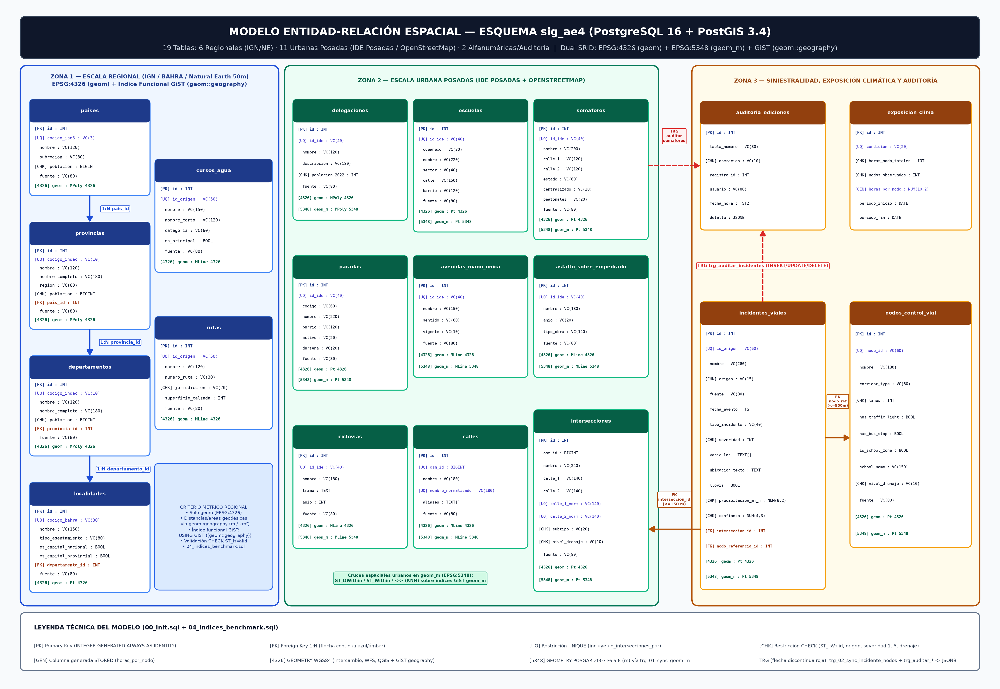
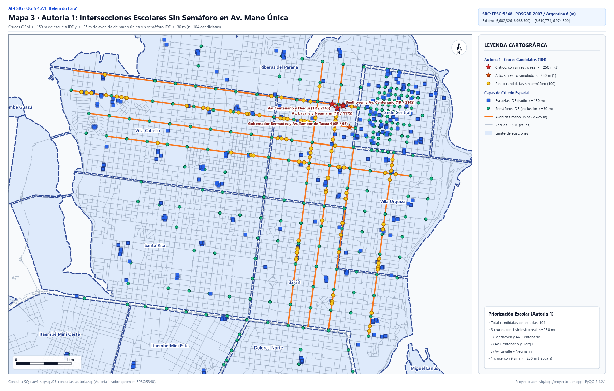
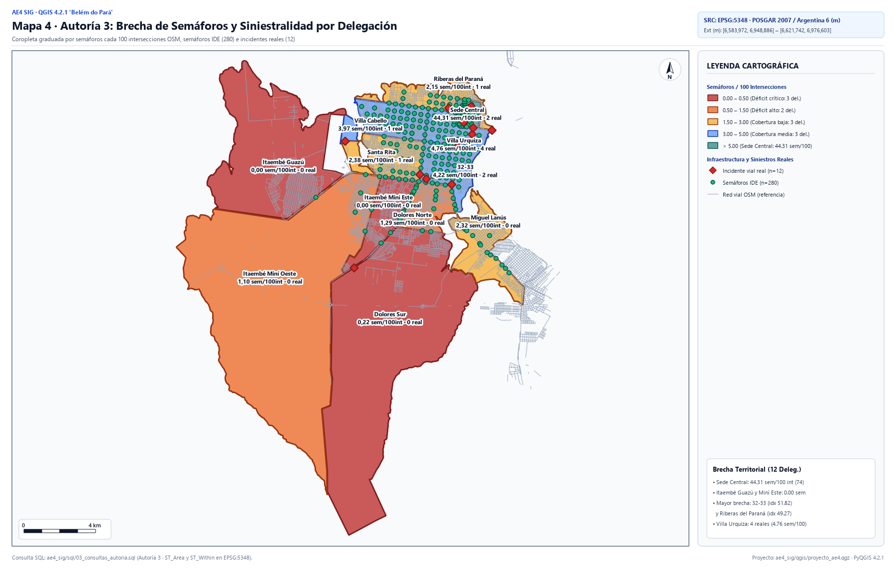
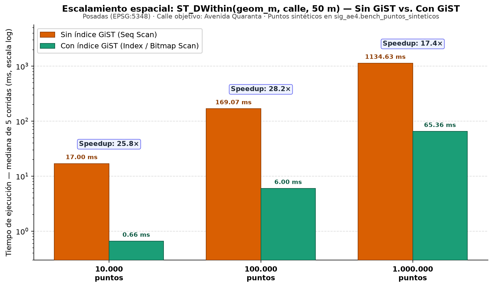
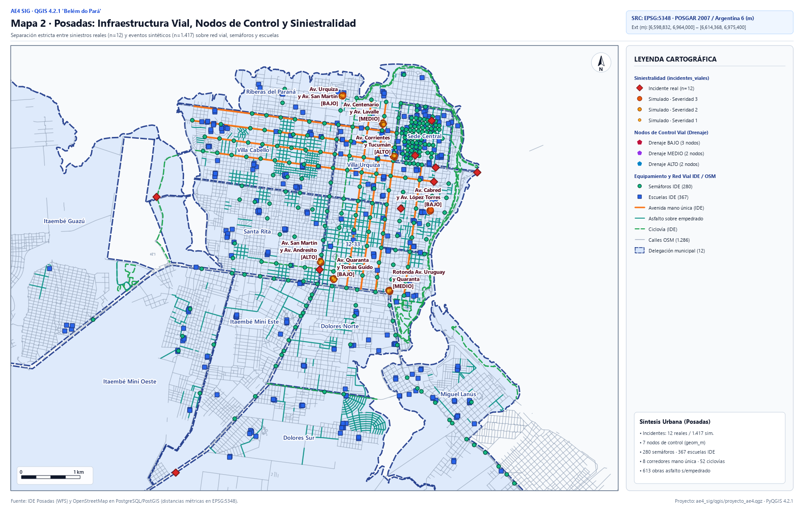

# UNIVERSIDAD DE LA CUENCA DEL PLATA
**Facultad de Ingeniería, Tecnología y Arquitectura**  
**Ingeniería en Sistemas de Información**  
**Sistemas de Información Geográfica**  
**Actividad de Evaluación 4 (AE4)**  
Sede Posadas

- **Autores:** Sánchez, Joaquín Sebastián; Nuñez, Santiago Agustín
- **DNI:** 45.452.416; 44.952.958
- **Profesor:** Edgar Rolando Ibáñez
- **Fecha de entrega:** 23 de noviembre de 2026
- **AÑO:** 2026

---

## Índice general
1. Introducción
2. Fuentes de datos y arquitectura tecnológica
3. Fase I: Diseño e implementación de la base de datos espacial
4. Fase II: Consultas espaciales y optimización con índices GiST
5. Fase III: Interoperabilidad cliente-servidor con QGIS 4.2.1
6. Conclusiones
7. Portafolio digital
8. Índice de figuras
9. Referencias

## Índice de tablas
- **Tabla 1.** Inventario de fuentes de datos oficiales y complementarias integradas en el esquema sig_ae4
- **Tabla 2.** Estrategia dual de sistemas de referencia espacial implementada en la base de datos
- **Tabla 3.** Resumen arquitectónico de restricciones, claves y triggers por bloque del esquema sig_ae4
- **Tabla 4.** Resultados de la auditoría integral de validación geométrica, referencial y topológica
- **Tabla 5.** Síntesis metodológica y resultados verificados de las consultas regionales obligatorias (incisos a–i)
- **Tabla 6.** Primeras 10 intersecciones escolares sobre avenidas de mano única sin semáforo (Autoría 1)
- **Tabla 7.** Tasas de siniestralidad por condición climática, nivel de drenaje experto y origen (Autoría 2A)
- **Tabla 8.** Comparación global de corredores con obra de asfalto sobre empedrado frente al resto de la red (Autoría 2C)
- **Tabla 9.** Indicadores de equipamiento vial, población y siniestralidad en las 12 delegaciones de Posadas (Autoría 3)
- **Tabla 10.** Benchmark EXPLAIN (ANALYZE, BUFFERS) en consultas espaciales reales y trampa geom::geography
- **Tabla 11.** Escalamiento de rendimiento espacial Sin GiST vs. Con GiST hasta un millón de puntos
- **Tabla 12.** Resumen de validación cruzada 1:1 de las 21 capas del proyecto QGIS 4.2.1 frente a PostgreSQL/PostGIS
- **Tabla 13.** Síntesis de pruebas transaccionales ABM, rechazos de integridad y bloqueo concurrente MVCC

---

## 1. Introducción

El crecimiento urbano sostenido de la ciudad de Posadas, capital de la provincia de Misiones, plantea desafíos concretos para la gestión de la infraestructura vial y la seguridad del tránsito. Entre las brechas operativas más relevantes se destacan la ausencia de semaforización en cruces cercanos a establecimientos escolares sobre avenidas de circulación rápida, la exposición de la calzada ante lluvias intensas en sectores con drenaje deficiente y la distribución desigual del equipamiento vial entre el área céntrica y las delegaciones periféricas.

Con el fin de modelar estas problemáticas bajo un enfoque reproducible de Sistemas de Información Geográfica (Olaya, 2014), este trabajo implementa la Opción A de la consigna (arquitectura cliente-servidor en PostgreSQL 16.4 y PostGIS 3.4.3 acoplada con QGIS 4.2.1 y GDAL 3.13.2). El diseño articula dos escalas complementarias: una regional sobre el Nordeste Argentino (NEA), Misiones y Sudamérica mediante servicios OGC WFS del Instituto Geográfico Nacional (IGN, s.f.) y Natural Earth 50m (Natural Earth, s.f.); y una urbana sobre Posadas que integra capas de la Infraestructura de Datos Espaciales municipal (Municipalidad de Posadas, s.f.), radios censales 2022 (Instituto Nacional de Estadística y Censos [INDEC], 2023) y la red vial de OpenStreetMap (OpenStreetMap Contributors, 2026).

Por rigor metodológico y transparencia científica, la tabla `sig_ae4.incidentes_viales` (`1.429` eventos) separa explícitamente dos orígenes mediante una restricción `CHECK` y reporta sus métricas por separado:

- **Relevamientos curados de prensa local (`origen = 'real'`):** `12` siniestros verificados ocurridos en Posadas entre enero y noviembre de 2026 (relevados de prensa local durante mediados de octubre y noviembre de 2026), sin registro pluviométrico asociado (`llovia IS NULL`).
- **Eventos sintéticos de demostración (`origen = 'simulado'`):** `1.417` incidentes generados para 2023–2025 en torno a `7` nodos de control vial, con variable booleana `llovia` (`457` lluvia y `960` seco) y exposición horaria acumulada (`40.348` h-nodo de lluvia y `143.612` h-nodo secas).
- **Nodos de control vial (`nodos_control_vial`):** `7` intersecciones estratégicas caracterizadas en campo según drenaje pluvial (`ALTO`, `MEDIO`, `BAJO`), carriles y equipamiento del entorno.

Los objetivos específicos del proyecto se resumen en cuatro ejes:

- Implementar un esquema espacial normalizado (`sig_ae4`) con estrategia dual de sistemas de referencia (`EPSG:4326`, `EPSG:5348` y `geography`) y triggers reactivos.
- Ingestar, sanear topológicamente (`ogr2ogr` y `ST_MakeValid`) y auditar `18.442` geometrías sin registros inválidos ni huérfanos.
- Resolver las `9` consultas regionales obligatorias (`a–i`), `3` análisis de autoría urbana y un benchmark de `34` índices GiST hasta `1.000.000` de puntos.
- Validar en QGIS 4.2.1 la conexión segura sin credenciales almacenadas, el conteo `1:1` de las `21` capas, el ciclo transaccional ABM y el bloqueo concurrente MVCC.

## 2. Fuentes de datos y arquitectura tecnológica

El entorno cliente-servidor se desplegó mediante contenedores Docker con PostgreSQL `16.4` (PostgreSQL Global Development Group, 2024) y PostGIS `3.4.3` (`GEOS 3.9.0`, `PROJ 7.2.1`) (PostGIS Project Steering Committee, 2024), escuchando en el puerto `5433` para evitar conflictos con instancias locales en `5432`. Esta configuración garantiza reproducibilidad entre equipos, aislamiento transaccional MVCC real, medición exacta con `EXPLAIN (ANALYZE, BUFFERS)` y acceso simultáneo desde clientes SQL, scripts Python, `GDAL 3.13.2` (GDAL/OGR Contributors, 2026) y `QGIS 4.2.1` (QGIS Development Team, 2026).

Las capas regionales provienen del GeoServer OGC WFS del IGN (`ign:provincia`, `ign:departamento`, `ign:localidad_bahra`, hidrografía y red vial), complementadas con Natural Earth 50m para cubrir los `12` países sudamericanos (dado que `ign:pais` publica solo el polígono argentino). En Posadas, las capas WFS/SHP de IDE Posadas se integraron con la red vial de OpenStreetMap y con `459` radios censales del Censo 2022 (INDEC, 2023), totalizando `331.753` habitantes agregados dentro de las `12` delegaciones municipales (`Tabla 1`).

**Tabla 1.** *Inventario de fuentes de datos oficiales y complementarias integradas en el esquema sig_ae4*

| Escala | Fuente oficial / origen | Tabla destino | Formato origen | SRID | Registros |
| :--- | :--- | :--- | :--- | :---: | ---: |
| Regional | Natural Earth 50m (complemento IGN) | `paises` | GeoJSON | 4326 | 12 |
| Regional | IGN WFS (`ign:provincia`) + INDEC 2022 | `provincias` | GeoJSON | 4326 | 24 |
| Regional | IGN WFS (`ign:departamento`) + INDEC 2022 | `departamentos` | GeoJSON | 4326 | 529 |
| Regional | IGN-BAHRA WFS (`ign:localidad_bahra`) | `localidades` | GeoJSON | 4326 | 3.528 |
| Regional | IGN WFS (aguas continentales perennes) | `cursos_agua` | GeoJSON | 4326 | 1.333 |
| Regional | IGN WFS (`vial_nacional` y `vial_provincial`) | `rutas` | GeoJSON | 4326 | 582 |
| Urbana | IDE Posadas WFS + 459 radios INDEC 2022 | `delegaciones` | GeoJSON / SHP | 4326 + 5348 | 12 |
| Urbana | IDE Posadas WFS (`Intersecciones_Semaforizadas`) | `semaforos` | GeoJSON | 4326 + 5348 | 280 |
| Urbana | IDE Posadas WFS (`unidades_funcionales_educativas`) | `escuelas` | GeoJSON | 4326 + 5348 | 367 |
| Urbana | IDE Posadas WFS (`Refugios_paradas__SIG_0`) | `paradas` | GeoJSON | 4326 + 5348 | 482 |
| Urbana | IDE Posadas WFS (`manos_unicas`) | `avenidas_mano_unica` | GeoJSON | 4326 + 5348 | 8 |
| Urbana | IDE Posadas WFS (`asfalto_sobreempedrado0`) | `asfalto_sobre_empedrado` | GeoJSON | 4326 + 5348 | 613 |
| Urbana | IDE Posadas WFS (`bicisendas_ciclovias0`) | `ciclovias` | GeoJSON | 4326 + 5348 | 52 |
| Urbana | OpenStreetMap (red vial urbana Posadas) | `calles` | JSON nodos | 4326 + 5348 | 1.286 |
| Urbana | OpenStreetMap (cruces normalizados) | `intersecciones` | JSON puntos | 4326 + 5348 | 7.898 |
| Urbana | Relevamiento experto de campo (drenaje) | `nodos_control_vial` | Registro Python | 4326 + 5348 | 7 |
| Urbana | Prensa local curada + Serie sintética | `incidentes_viales` | JSONL | 4326 + 5348 | 1.429 |
| Alfanum. | Serie meteorológica horaria (2023–2025) | `exposicion_clima` | JSON | — | 2 |
| Auditoría | Triggers PL/pgSQL (`fn_auditar_edicion`) | `auditoria_ediciones` | JSONB | — | 8 |

*Nota.* En `cursos_agua` se consolidan 41 tramos principales (Río Paraná, Río Uruguay y Río Iguazú, filtrando homónimos patagónicos fuera de la Cuenca del Plata) y 1.292 afluentes en Misiones. En `rutas` se integran 286 tramos nacionales y 296 tramos provinciales. En `incidentes_viales` coexisten 12 registros `real` y 1.417 `simulado`. La entidad `nodos_control_vial` se denomina así en el informe y en la Figura 1 como nombre conceptual académico de la tabla de nodos de referencia del esquema SQL. `auditoria_ediciones` inicia en 0 tras la carga ETL y alcanza 8 operaciones tras ejecutar el protocolo transaccional de la Fase III (`05_edicion_transacciones.sql`).

## 3. Fase I: Diseño e implementación de la base de datos espacial

### 3.1 Infraestructura y organización en esquemas

El servidor separa la ingestión en dos esquemas: `staging`, que recibe geometrías y atributos crudos sin restricciones restrictivas para aislar defectos de origen, y `sig_ae4`, esquema productivo normalizado con `19` tablas (`6` regionales, `11` urbanas y `2` alfanuméricas). Esta arquitectura desacoplada permite auditar codificaciones DBF heredadas y reparar topologías en SQL antes de validar las reglas productivas.

### 3.2 Estrategia de sistemas de referencia

Operar mediciones euclidianas directamente sobre coordenadas angulares (`EPSG:4326`) distorsiona distancias y buffers (Olaya, 2014): a latitud de Posadas (`-27,37°`), un grado de longitud mide cerca de `98,9 km` frente a `110,8 km` en latitud (`~11%` de anisotropía). Por otro lado, ninguna faja plana única cubre sin deformación todo el territorio nacional ni el continente sudamericano.

En consecuencia, se adoptó una arquitectura dual para el ámbito urbano y geodésica esferoidal para el regional (`Tabla 2`). En Posadas (`-55,9°` O) se eligió `EPSG:5348` (*POSGAR 2007 / Argentina Faja 6*, meridiano central `57°` O), ubicada a solo `1,1°` de su eje central frente a los `1,9°` respecto de la Faja 7 (`EPSG:5349`), minimizando el factor de escala lineal. La columna proyectada `geom_m` se recalcula automáticamente mediante el trigger `trg_01_sync_geom_m` ante cada `INSERT` o `UPDATE` de `geom`.

**Tabla 2.** *Estrategia dual de sistemas de referencia espacial implementada en la base de datos*

| Sistema / Tipo | Alcance en sig_ae4 | Unidades | Justificación técnica y mecanismo de mantenimiento |
| :--- | :--- | :---: | :--- |
| `EPSG:4326` (WGS 84 geográfico) | Columna `geom` en las 17 tablas espaciales | Grados decimales | Estándar universal de intercambio WFS/GeoJSON y visualización directa en QGIS; mantiene compatibilidad nativa con fuentes IGN e IDE Posadas. |
| `EPSG:5348` (POSGAR 2007 / Argentina Faja 6) | Columna `geom_m` en las 11 tablas urbanas | Metros planos | Meridiano central 57° O óptimo para Posadas (-55,9° O). Sincronizada automáticamente `BEFORE INSERT OR UPDATE OF geom` por `trg_01_sync_geom_m`. |
| `geography` (WGS 84 esferoidal) | Consultas regionales `a–i` sobre `geom::geography` | Metros sobre elipsoide | Argentina abarca 7 fajas POSGAR (5343–5349) y Sudamérica supera cualquier proyección plana local. Acelerada mediante índices GiST funcionales. |

*Nota.* Elaboración propia a partir de la definición DDL en `00_init.sql` y el estándar POSGAR 2007 del Instituto Geográfico Nacional.

### 3.3 Modelo relacional espacial, restricciones e integridad

De acuerdo con el estándar *Simple Feature Access* (Open Geospatial Consortium [OGC], 2011), todas las tablas espaciales exigen validez geométrica estricta mediante `NOT NULL CHECK (ST_IsValid(geom))`. Las `19` claves primarias emplean `INTEGER GENERATED ALWAYS AS IDENTITY` para habilitar la edición concurrente desde QGIS sin colisiones de secuencias, acompañadas por restricciones de dominio (`origen`, `severidad 1..5`, `jurisdiccion`, `nivel_drenaje`) y unicidad en códigos oficiales y pares normalizados de calles (`Figura 1` y `Tabla 3`).

El comportamiento reactivo se implementa mediante tres funciones PL/pgSQL: `fn_sync_geom_m()`, disparada como `trg_01_sync_geom_m` en las `11` tablas urbanas; `fn_sync_incidente_nodos()`, nombrada `trg_02_sync_incidente_nodos` para ejecutarse alfabéticamente después de `trg_01_sync_geom_m` y enlazar cada incidente con la intersección OSM más cercana (`<= 150 m`) y el nodo de control más próximo (`<= 500 m`); y `fn_auditar_edicion()`, que registra cada cambio `INSERT`, `UPDATE` o `DELETE` sobre `semaforos` e `incidentes_viales` en la bitácora `JSONB` `auditoria_ediciones`.



**Figura 1.** *Modelo entidad-relación espacial completo del esquema sig_ae4.* Incluye las 19 tablas distribuidas en escala regional, escala urbana y analítica/auditoría, claves primarias y foráneas, restricciones CHECK, dualidad SRID (4326/5348) y triggers. Elaboración propia.

**Tabla 3.** *Resumen arquitectónico de restricciones, claves y triggers por bloque del esquema sig_ae4*

| Bloque del esquema (`sig_ae4`) | Geometría / SRID | Claves y restricciones principales | Triggers y rol funcional |
| :--- | :--- | :--- | :--- |
| Escala regional (`6` tablas: límites, localidades, hidrografía, rutas) | `MultiPolygon`, `MultiLineString`, `Point` (`4326`) | PK `IDENTITY`, UQ códigos (`ISO3`, `INDEC`, `BAHRA`, `id_origen`), `3` FKs jerárquicas, CHK `ST_IsValid`, `jurisdiccion`, `poblacion>=0` | Base territorial Sudamérica / Argentina / Misiones para consultas `a–i` |
| Infraestructura urbana (`10` tablas: IDE Posadas, OSM y control vial) | `MultiPolygon`, `MultiLineString`, `Point` (`4326` y `5348`) | PK `IDENTITY`, UQ (`id_ide`, `osm_id`, `node_id`, par de calles), CHK `ST_IsValid`, `lanes>0`, `nivel_drenaje`, `subtipo` | `trg_01_sync_geom_m` en las `10` tablas; auditoría DML en `semaforos` |
| Siniestralidad urbana (`incidentes_viales`) | `Point` (`4326` y `5348`) | PK `IDENTITY`, UQ `id_origen`, CHK `ST_IsValid`, `origen` (`'real'`/`'simulado'`), `severidad 1..5`, `2` FKs (`interseccion_id`, `nodo_referencia_id`) | `trg_01_sync_geom_m`, `trg_02_sync_incidente_nodos` (`150 m` / `500 m`) y auditoría DML |
| Soporte analítico y auditoría (`exposicion_clima`, `auditoria_ediciones`) | Alfanuméricas (columna `GENERATED` y `JSONB`) | PK `IDENTITY`, UQ `condicion` (`lluvia`/`seco`), CHK `operacion` (`INSERT`/`UPDATE`/`DELETE`) | Denominador horario climático (`horas_por_nodo`) y bitácora inmutable de cambios |

*Nota.* El inventario detallado tabla por tabla figura en la Tabla 1 y las relaciones completas en la Figura 1. En `exposicion_clima`, `horas_por_nodo` es una columna generada almacenada (`horas_nodo_totales / 7`).

### 3.4 Carga, reparación topológica y validación

El flujo ETL carga primero las capas en `staging` y las sanea declarativamente al promoverlas a `sig_ae4`. Durante la prueba de ingestión externa con `ogr2ogr` (`GDAL 3.13.2`) leyendo el Shapefile comprimido de delegaciones mediante `/vsizip/` y `SHAPE_ENCODING=ISO-8859-1` (GDAL/OGR Contributors, 2026), los caracteres acentuados (`Itaembé Guazú`, `Itaembé Miní Oeste`) ingresaron correctamente, pero `ST_IsValid` detectó dos autointersecciones puntuales en los polígonos municipales originales.

Esta detección temprana en `staging` justificó aplicar la secuencia `ST_Multi(ST_CollectionExtract(ST_MakeValid(ST_Force2D(geom)), 3))` sobre la capa de delegaciones antes de poblar producción (`Tabla 4`). De modo complementario, al reconstruir las `1.286` calles urbanas de OpenStreetMap desde nodos ordenados, se segmentaron sub-tramos independientes cuando la distancia entre vértices consecutivos superaba `300 m`, evitando conexiones espurias entre arterias homónimas discontinuas.

```sql
-- Normalización y reparación topológica staging -> sig_ae4 (delegaciones)
INSERT INTO sig_ae4.delegaciones
  (id_ide, nombre, poblacion_2022, geom, geom_m)
SELECT dc.id_ide, dc.nombre, COALESCE(SUM(rp.poblacion_n), 0)::INTEGER,
       dc.geom, ST_Transform(dc.geom, 5348)
FROM (
  SELECT REPLACE(TRIM(d.id_ide), 'DELEGACIONES_MUNICIPALES_POSADAS_',
                 'DELEG_POSADAS_') AS id_ide,
         COALESCE(NULLIF(TRIM(d.nombre), ''), TRIM(d.id_ide)) AS nombre,
         ST_Multi(ST_CollectionExtract(ST_MakeValid(ST_Force2D(
           ST_SetSRID(ST_GeomFromGeoJSON(d.geom_json), 4326))), 3)) AS geom
  FROM staging.ide_delegaciones d
) dc
LEFT JOIN radios_pts rp ON ST_Within(rp.pt, dc.geom)
GROUP BY dc.id_ide, dc.nombre, dc.geom;
```

**Tabla 4.** *Resultados de la auditoría integral de validación geométrica, referencial y topológica*

| Control ejecutado (`01_validacion.sql`) | Alcance evaluado | Resultado observado | Estado |
| :--- | :--- | :--- | :---: |
| Validez geométrica (`ST_IsValid`) y no nulidad | 17 tablas espaciales (`18.442` filas) | `0` geometrías nulas; `0` inválidas | OK |
| Integridad de SRID (`geom` y `geom_m`) | 17 tablas `4326` + 11 urbanas `5348` | `0` errores SRID en `4326`; `0` en `5348` | OK |
| Integridad referencial (5 relaciones FK) | Jerarquía IGN + vínculos de incidentes | `0` registros huérfanos | OK |
| Trigger `trg_02_sync_incidente_nodos` (`real`) | `12` incidentes reales | `11` con intersección (`91,7%`); `4` con nodo (`33,3%`) | OK |
| Trigger `trg_02_sync_incidente_nodos` (`simulado`) | `1.417` incidentes simulados | `1.417` con intersección y nodo (`100,0%`) | OK |
| Total vinculado en `incidentes_viales` | `1.429` incidentes totales | `1.428` (`99,9%`) intersec.; `1.421` (`99,4%`) nodo | OK |
| Sanity check 4A: Capitales nacionales/prov. | `localidades` BAHRA | `1` cap. nacional + `23` provinciales = `24` | OK |
| Sanity check 4B: Vecindad de países NE 50m | `12` países sudamericanos | `ST_Touches = ST_Intersects` (`0` solapes) | OK |
| Sanity check 4C: Vecindad provincial IGN | `24` provincias argentinas | Misiones limita solo con Corrientes (`ST_Touches`) | OK |
| Sanity check 4D: Ríos principales en Misiones | Paraná (`39`), Uruguay (`1`), Iguazú (`1`) | `16` intersecciones dpto.-río consistentes | OK |

*Nota.* Resultados de la ejecución verificada de `sql/01_validacion.sql` (disponible en el Portafolio Digital). Las `18.442` geometrías corresponden a `6.008` entidades regionales y `12.434` urbanas. El único incidente real sin cruce OSM a `<= 150 m` se ubica sobre `Av. Alicia Moreau de Justo (Ex Ruta 213)`.

## 4. Fase II: Consultas espaciales y optimización con índices GiST

### 4.1 Consultas obligatorias — Escala regional (incisos a–i)

Las nueve consultas regionales obligatorias (`02_consultas_a_i.sql`) emplean el tipo esferoidal `geography` sobre `EPSG:4326` para calcular áreas, longitudes y distancias sobre el elipsoide WGS 84 sin distorsión latitudinal, unificando previamente los cursos fluviales segmentados mediante `ST_Union` para evitar dobles conteos (`Figura 2` y `Tabla 5`). En accesibilidad troncal e hidrográfica (`g–i`), se observa una cobertura homogénea: el extremo más alejado del río Paraná dentro de Misiones (`Bernardo de Irigoyen`, `97,27 km`) queda holgadamente dentro del umbral de `200 km`, mientras `CROSS JOIN LATERAL` con operador KNN `<->` asigna `67` localidades a la `RN 12`, `66` a la `RN 14` y `7` a la `RN 101`.

Un hallazgo metodológico clave del inciso `d` surgió al contrastar `ST_Touches` frente a `ST_Intersects`. Bajo la especificación topológica DE-9IM adoptada por PostGIS (OGC, 2011; PostGIS Project Steering Committee, 2024), `ST_Touches(A, B)` exige interiores estrictamente disjuntos (`I(A) ∩ I(B) = ∅`). Mientras los `12` países de Natural Earth coinciden exactamente entre ambos predicados (`0` solapamientos), la capa provincial del IGN presenta `4` micro-solapamientos bidimensionales (`0,00` a `5,29 m²` en `Entre Ríos–Corrientes`, `Buenos Aires–Entre Ríos`, `San Juan–La Rioja` y `Jujuy–Salta`) que hacen fallar `ST_Touches` pese a ser fronteras vecinas reales.


**Figura 2.** *Contexto regional del Nordeste Argentino, hidrografía principal y red vial troncal.* Integración en PostGIS de capas IGN WFS, localidades BAHRA y países Natural Earth 50m renderizada en QGIS 4.2.1. Elaboración propia.

**Tabla 5.** *Síntesis metodológica y resultados verificados de las consultas regionales obligatorias (incisos a–i)*

| Inciso | Objetivo analítico | Operadores / funciones PostGIS | Resultados clave verificados |
| :---: | :--- | :--- | :--- |
| `a` | Unión relacional localidad → país | `JOIN` jerárquico (4 tablas) | Muestra nacional (`50` filas) + `140` localidades completas de Misiones en `17` departamentos. |
| `b` | Jerarquía de capitales | `CASE`, `JOIN`, filtros booleanos | `24` capitales (`1` nacional: Ciudad de Buenos Aires; `23` provinciales, incluida Posadas). |
| `c` | Superficie y densidad poblacional | `ST_Area(geom::geography)` / 1e6 | `12` países (Brasil `8,47M km²`, Arg. `2,78M km²`) y `17` deptos. Misiones (Capital `407,39 hab/km²`). |
| `d` | Adyacencia y fronteras | `ST_Touches` vs `ST_Intersects` | Países `0` discrepancias (`BR=9, AR=5`); provincias `4` micro-solapes IGN (`0,00–5,29 m²`). |
| `e` | Overlays ríos vs. jurisdicciones | `ST_Union`, `ST_Intersects` | Paraná y Uruguay cruzan `7` deptos. c/u; Iguazú `2`. Uruguay atraviesa `3` países. |
| `f` | Longitud segmentada de ríos | `ST_Length(geography)`, `ST_CollectionExtract`, `ST_Intersection(..., 2)` | En Misiones: Uruguay `336,989 km`, Paraná `246,439 km`, Iguazú `132,217 km` (total `1.845,290 km` Paraná). |
| `g` | Alejamiento extremo al Paraná | `ST_Distance(geography)` | `Bernardo de Irigoyen` es la más alejada (`97,266 km`), seguida por `Alicia Baja` (`94,259 km`). |
| `h` | Accesibilidad a rutas nacionales | `CROSS JOIN LATERAL` + `<->` + `ST_Distance` | `RN 12`: `67` loc. (`4,415 km` prom.); `RN 14`: `66` (`14,728 km` prom.); `RN 101`: `7` (`5,727 km` prom.). |
| `i` | Localidades `< 200 km` del Paraná | `ST_DWithin(geography)` (200 km) | `140` localidades en Misiones (`100%`) y `1.156` en `9` provincias argentinas. |

*Nota.* Resultados obtenidos mediante `sql/02_consultas_a_i.sql` evaluados sobre elipsoide WGS84 (`geography`). En el inciso `c`, San Pedro contrasta como el departamento más extenso de Misiones (`3.818,06 km²`, `9,11 hab/km²`) frente a Capital (`964,48 km²`).

### 4.2 Consultas de autoría — Escala urbana de Posadas

Las consultas de autoría propias (`03_consultas_autoria.sql`) operan sobre la columna métrica plana `geom_m` (`EPSG:5348`) y exponen las geometrías `4326` junto con clave `id` única para integrarse directamente como capas SQL en QGIS, manteniendo separadas las métricas `real` y `simulado`.

#### 4.2.1 Incorporación de semaforización en zona escolar (Autoría 1)

Esta consulta detecta intersecciones OSM ubicadas simultáneamente a `<= 150 m` de una escuela oficial y a `<= 25 m` de una avenida de mano única, pero sin semáforo dentro de un radio de exclusión de `30 m` (`NOT EXISTS` con `ST_DWithin`). El cruce arrojó **`104` intersecciones candidatas** (`56` próximas a escuelas estatales y `48` a privadas).

Aunque ninguna esquina registró siniestros dentro de `50 m`, al ampliar la evaluación al corredor (`250 m`) tres cruces destacan por combinar `1` siniestro real y la mayor concentración simulada (`Tabla 6` y `Figura 3`): **Beethoven y Avenida Centenario**, **Avenida Centenario y Derqui** y **Avenida Lavalle y Neumann**, en el entorno inmediato de `C.F.P. Nº 16` y `E.P.E.T. Nº 01 "UNESCO"`. Este criterio permite priorizar nuevos semáforos o sendas peatonales seguras sobre esos dos ejes.

```sql
-- Autoría 1: Intersecciones escolares en av. mano única sin semáforo
SELECT i.id, i.nombre, esc.escuela_cercana, esc.dist_escuela_m,
       ave.avenida_mano_unica, stats.siniestros_corredor_250m_real,
       stats.siniestros_corredor_250m_simulado, i.geom
FROM sig_ae4.intersecciones i
JOIN LATERAL (
  SELECT e.nombre AS escuela_cercana,
         ROUND(ST_Distance(i.geom_m, e.geom_m)::numeric, 1) AS dist_escuela_m
  FROM sig_ae4.escuelas e
  WHERE ST_DWithin(i.geom_m, e.geom_m, 150.0)
  ORDER BY i.geom_m <-> e.geom_m LIMIT 1
) esc ON TRUE
JOIN LATERAL (
  SELECT a.nombre AS avenida_mano_unica
  FROM sig_ae4.avenidas_mano_unica a
  WHERE ST_DWithin(i.geom_m, a.geom_m, 25.0)
  ORDER BY i.geom_m <-> a.geom_m LIMIT 1
) ave ON TRUE
WHERE NOT EXISTS (
  SELECT 1 FROM sig_ae4.semaforos s
  WHERE ST_DWithin(i.geom_m, s.geom_m, 30.0)
);
```

**Tabla 6.** *Primeras 10 intersecciones escolares sobre avenidas de mano única sin semáforo (Autoría 1)*

| Intersección candidata (OSM) | Escuela cercana (IDE) | Sector | Dist. (m) | Avenida mano única | 250 m (R/S) |
| :--- | :--- | :---: | ---: | :--- | :---: |
| Beethoven y Avenida Centenario | C.F.P. Nº 16 | Estatal | 52,9 | AV. CENTENARIO | 1 / 214 |
| Avenida Centenario y Derqui | E.P.E.T. Nº 01: "UNESCO" | Estatal | 136,3 | AV. CENTENARIO | 1 / 214 |
| Avenida Lavalle y Neumann | E.P.E.T. Nº 01: "UNESCO" | Estatal | 21,4 | AV. LAVALLE | 1 / 117 |
| Gobernador Bermúdez y Av. Tambor de Tacuarí | BACH. HUMANISTA "MONS. J. KEMERER" | Privado | 142,8 | AV. TAMBOR DE TACUARÍ | 0 / 9 |
| Pasaje Labat y Avenida Lavalle | GUARDERIA "CASA DEL NIÑO" I.P.S. 9001 | Estatal | 17,8 | AV. LAVALLE | 0 / 0 |
| Avenida Kolping y Av. Tambor de Tacuarí | INST. SUPERIOR "VERBO DIVINO" | Privado | 20,4 | AV. TAMBOR DE TACUARÍ | 0 / 0 |
| Avenida Santa Catalina y Suecia | INST. ADVENTISTA ALTA GRACIA | Privado | 21,3 | AV. SANTA CATALINA | 0 / 0 |
| Calle 96 y Avenida Santa Catalina | INST. POLITECNICO SAN ARNOLDO JANSSEN | Privado | 22,1 | AV. SANTA CATALINA | 0 / 0 |
| Cucchiaroni y Av. Tambor de Tacuarí | CEMU Nº 01 | Estatal | 22,1 | AV. TAMBOR DE TACUARÍ | 0 / 0 |
| Carola Lorenzini y Av. Ramón Martirenez | INST. CRISTIANO EMANUEL | Privado | 23,0 | AV. FRANCISCO DE HARO | 0 / 0 |

*Nota.* Subconjunto ordenado de las 104 candidatas totales (56 estatales y 48 privadas). La columna `250 m (R/S)` indica siniestros reales (`R`) y simulados (`S`) en un corredor de 250 m. Todas las filas registraron 0 eventos en el radio estricto de 50 m.



**Figura 3.** *Mapa de las 104 intersecciones escolares en avenidas de mano única sin semáforo.* Destaca las tres intersecciones críticas con siniestralidad real en corredor de 250 m sobre Av. Centenario y Av. Lavalle. Elaboración propia.

#### 4.2.2 Mantenimiento preventivo y sensibilidad climática (Autoría 2)

La segunda línea analiza la vulnerabilidad húmeda de la red en tres consultas complementarias. La Parte 2A relaciona los incidentes dentro de `500 m` de los `7` nodos de control experto (`ALTO`, `MEDIO`, `BAJO` drenaje) normalizados por la exposición horaria del período 2023–2025 (`5.764` h de lluvia y `20.516` h secas por nodo). En los eventos simulados (`Tabla 7`), la razón de riesgo bajo lluvia asciende a **`1,74×`** en drenaje `BAJO` y `MEDIO` frente a **`1,59×`** en drenaje `ALTO`; los `4` incidentes reales cercanos carecen de dato meteorológico (`llovia IS NULL`), por lo que el patrón climático se acota estrictamente al conjunto demostrativo.

**Tabla 7.** *Tasas de siniestralidad por condición climática, nivel de drenaje experto y origen (Autoría 2A)*

| Drenaje | Origen | Nodos | Total | Lluvia | Seco | Sin dato | Tasa lluvia /1000h | Tasa seco /1000h | Razón riesgo |
| :---: | :---: | ---: | ---: | ---: | ---: | ---: | ---: | ---: | :---: |
| BAJO | `real` | 3 | 1 | 0 | 0 | 1 | 0,000 | 0,000 | — |
| MEDIO | `real` | 2 | 2 | 0 | 0 | 2 | 0,000 | 0,000 | — |
| ALTO | `real` | 2 | 1 | 0 | 0 | 1 | 0,000 | 0,000 | — |
| BAJO | `simulado` | 3 | 581 | 191 | 390 | 0 | 11,046 | 6,337 | 1,74× |
| MEDIO | `simulado` | 2 | 408 | 134 | 274 | 0 | 11,624 | 6,678 | 1,74× |
| ALTO | `simulado` | 2 | 428 | 132 | 296 | 0 | 11,450 | 7,214 | 1,59× |

*Nota.* Exposición acumulada (trienio 2023–2025) por nivel: `17.292,00` h lluvia y `61.548,00` h seco en `BAJO` (3 nodos); `11.528,00` h lluvia y `41.032,00` h seco en `MEDIO` y `ALTO` (2 nodos c/u). Los 4 eventos `real` (2026) dentro de 500 m carecen de registro pluviométrico (`Sin dato = 100%`), por lo que las tasas por 1.000 h-nodo y la razón de riesgo se evalúan exclusivamente sobre la serie `simulado` (2023–2025). Severidad promedio en simulados: `1,39/1,39` (`BAJO`), `1,46/1,44` (`MEDIO`), `1,41/1,41` (`ALTO`).

En forma complementaria, la Parte 2B jerarquiza las `30` calles con mayor índice de severidad bajo lluvia (`buffer 40 m`), encabezadas por **Avenida San Martín** (puntaje `57,89`), **Berón de Astrada** (`33,36`), **Avenida Lavalle** (`33,36`), **Carola Lorenzini** (`31,21`) y **Uruguay** (`30,68`). A su vez, la Parte 2C evalúa las `1.286` calles completas según cuenten con obras de `asfalto_sobre_empedrado` (`<= 25 m`, `Tabla 8`): aunque las arterias asfaltadas concentran el tráfico principal, su proporción relativa bajo lluvia (`1,66×`) resulta menor que en las vías sin repavimentar (`1,82×`), orientando tanto la limpieza preventiva de sumideros en corredores troncales como la pavimentación de arterias secundarias.

**Tabla 8.** *Comparación global de corredores con obra de asfalto sobre empedrado frente al resto de la red (Autoría 2C)*

| Obra asfalto s/empedrado | Calles | Long. (km) | Reales | Sim. lluvia | Sim. seco | Totales | Sim. lluvia/km | % lluvia sim. | Razón L/S |
| :--- | ---: | ---: | ---: | ---: | ---: | ---: | ---: | ---: | :---: |
| Sí (`<= 25 m`) | 552 | 1.019,30 | 18 | 926 | 1.987 | 2.931 | 0,91 | 31,8% | 1,66× |
| No | 734 | 527,00 | 5 | 71 | 139 | 215 | 0,13 | 33,8% | 1,82× |

*Nota.* Las columnas `Reales`, `Sim. lluvia`, `Sim. seco` y `Totales` contabilizan intersecciones espaciales calle-evento dentro del buffer de 40 m (`18 + 5 = 23` cruces sobre los 12 siniestros reales únicos y `2.931 + 215 = 3.146` sobre los 1.429 totales), dado que un incidente en una esquina impacta simultáneamente a más de una arteria concurrente. Por ello, las razones lluvia/seco (`1,66×` vs `1,82×`) se interpretan de forma relativa entre ambos grupos. Severidad promedio simulada (lluvia/seco): `1,42/1,41` con obra y `1,35/1,44` sin obra.

#### 4.2.3 Brecha de equipamiento por delegación municipal (Autoría 3)

La tercera consulta evalúa la equidad territorial entre las `12` delegaciones de Posadas cruzando semáforos, refugios, escuelas, población 2022 y siniestralidad mediante el indicador compuesto `indice_brecha_prioridad`:

```sql
indice_brecha_prioridad =
  ((siniestros_real * 3.0 + siniestros_simulado) / area_km2)
  * (1.0 / (1.0 + (semaforos_cada_100_intersecciones / 10.0)))
```

Los resultados (`Tabla 9` y `Figura 4`) evidencian dos asimetrías complementarias. En cobertura de control vial, **Sede Central** concentra `44,31` semáforos cada `100` intersecciones mientras las delegaciones periféricas en expansión **Itaembé Guazú** e **Itaembé Miní Este** carecen por completo de semáforos oficiales pese a sumar `37.566` habitantes y `22` escuelas. En prioridad compuesta, los picos se registran en **32-33** (`51,82`), **Riberas del Paraná** (`49,27`) y **Villa Urquiza** (`4` siniestros reales), sugiriendo una política dual de semaforización periférica y pacificación en sectores de alta densidad.

**Tabla 9.** *Indicadores de equipamiento vial, población y siniestralidad en las 12 delegaciones de Posadas (Autoría 3)*

| Delegación | Área km² | Pob. 2022 | Inters. | Sem. | Sem/100 | Par. | Esc. | Real | Sim. | Brecha |
| :--- | ---: | ---: | ---: | ---: | ---: | ---: | ---: | ---: | ---: | ---: |
| Sede Central | 1,93 | 14.911 | 167 | 74 | 44,31 | 44 | 68 | 2 | 67 | 6,96 |
| Villa Urquiza | 6,41 | 34.203 | 630 | 30 | 4,76 | 61 | 49 | 4 | 183 | 20,60 |
| 32-33 | 5,54 | 26.117 | 592 | 25 | 4,22 | 46 | 26 | 2 | 402 | 51,82 |
| Riberas del Paraná | 6,82 | 29.005 | 512 | 11 | 2,15 | 38 | 22 | 1 | 405 | 49,27 |
| Villa Cabello | 7,90 | 47.379 | 781 | 31 | 3,97 | 71 | 52 | 1 | 0 | 0,27 |
| Santa Rita | 8,25 | 34.784 | 755 | 18 | 2,38 | 37 | 24 | 1 | 133 | 13,30 |
| Itaembé Guazú | 39,06 | 16.993 | 663 | 0 | 0,00 | 18 | 10 | 0 | 0 | 0,00 |
| Itaembé Miní Este | 7,42 | 20.573 | 462 | 0 | 0,00 | 18 | 12 | 0 | 0 | 0,00 |
| Dolores Sur | 74,94 | 29.015 | 454 | 1 | 0,22 | 37 | 35 | 0 | 0 | 0,00 |
| Itaembé Miní Oeste | 94,52 | 21.652 | 456 | 5 | 1,10 | 27 | 14 | 0 | 0 | 0,00 |
| Dolores Norte | 5,96 | 25.835 | 464 | 6 | 1,29 | 21 | 18 | 0 | 0 | 0,00 |
| Miguel Lanús | 10,69 | 31.286 | 560 | 13 | 2,32 | 25 | 29 | 0 | 0 | 0,00 |

*Nota.* Totales contenidos dentro de los polígonos de delegación: `269,44 km²`, `331.753` habitantes, `6.496` intersecciones, `214` semáforos, `443` paradas, `359` escuelas, `11` siniestros reales y `1.190` simulados (`1` incidente real sobre Ex Ruta 213 y `227` simulados en bordes costeros/arteriales yacen fuera del límite oficial de delegación).



**Figura 4.** *Coroplético de cobertura semafórica cada 100 intersecciones y siniestros reales por delegación.* Contrasta el centro urbano semaforizado frente al déficit de Itaembé Guazú e Itaembé Miní Este. Elaboración propia.

### 4.3 Optimización mediante índices espaciales GiST

Los índices **B-tree** tradicionales ordenan claves escalares unidimensionales (`<`, `=`, `>`), pero no preservan la vecindad en el plano bidimensional. Para resolver predicados espaciales, PostGIS implementa sobre **GiST** (*Generalized Search Tree*) una estructura **R-Tree** (Guttman, 1984) que agrupa cada geometría mediante su Rectángulo Mínimo Envolvente (*MBR*). Toda búsqueda indexada ejecuta un **filtro grueso** mediante cajas envolventes (`&&` en `ST_Intersects`, `ST_Within` y `ST_DWithin`, o `<->` en vecinos cercanos KNN) y luego un **refinamiento exacto** con GEOS sobre las tuplas candidatas. Frente a **SP-GiST** (más orientado a puntos homogéneos) o **BRIN** (dependiente del orden físico de almacenamiento), GiST soporta geometrías heterogéneas y ordenamiento KNN nativo.

Se implementaron **`34` índices GiST** (`1.928 kB` acumulados): `22` en las tablas urbanas (`geom` y `geom_m`) y `12` en las regionales (`geom` más índices funcionales `USING GIST ((geom::geography))`). Estos últimos evitan una trampa habitual de PostGIS: castear `geom::geography` en una consulta invalida el índice estándar `gist_geometry_ops_2d` y fuerza un `Seq Scan` al cambiar el tipo y la familia de operadores (`gist_geography_ops`).

Las mediciones sobre `EXPLAIN (ANALYZE, BUFFERS)` (mediana de `5` corridas, `Tabla 10`) confirman aceleraciones de **`11,87×`** a **`47,80×`** en cruces reales, y un salto de **`58,88×`** al incorporar el índice funcional `(geom::geography)` (reduciendo de `~4` minutos a `4,08 s`). Asimismo, la prueba de escalamiento sintético hasta **`1.000.000` de puntos** (`Tabla 11` y `Figura 5`) demuestra que GiST contiene el crecimiento de lecturas de buffers (`8.600` frente a `3.008.336` en `Seq Scan`), sosteniendo aceleraciones de `17,36×` a `28,16×`.

**Tabla 10.** *Benchmark EXPLAIN (ANALYZE, BUFFERS) en consultas espaciales reales y trampa geom::geography*

| Escenario de consulta (`5` corridas, mediana) | Filas | Sin GiST (ms) | Con GiST (ms) | Speedup | Plan observado (Sin → Con) |
| :--- | ---: | ---: | ---: | :---: | :--- |
| 1) `intersecciones × calles` (`ST_DWithin 30 m`) | 18.194 | 4.009,167 | 337,744 | **11,87×** | `Seq Scan` → `Index Scan (geom_m)` |
| 2) `incidentes × delegaciones` (`ST_Within`) | 1.201 | 22,916 | 1,779 | **12,88×** | `Seq Scan` → `Index Scan (geom_m)` |
| 3) `localidades × cursos_agua` (KNN `<-> LATERAL`) | 3.528 | 5.459,990 | 114,235 | **47,80×** | `Sort + Seq Scan` → `Index Scan (geom)` |
| 4) Trampa `geom::geography` (`ST_DWithin 200 km`) | 176.665 | 240.178,937 | 4.078,849 | **58,88×** | Solo `geom` (`Seq Scan`) → Funcional `(geom::geography)` |

*Nota.* Mediana de 5 corridas en PostgreSQL 16.4 / PostGIS 3.4.3. En el escenario 3, los bloques leídos descendieron de `1.238.382` a `35.833`; en el escenario 4 (`geom::geography`), la columna «Sin GiST» evalúa el uso exclusivo del índice estándar en `geom` (`min=239.142,97 ms`, `max=242.146,74 ms`) frente al índice funcional (`282.565` → `45.853` buffers).

**Tabla 11.** *Escalamiento de rendimiento espacial Sin GiST vs. Con GiST hasta un millón de puntos*

| Volumen sintético | Coincidencias (`<= 50 m`) | Sin GiST (ms) | Con GiST (ms) | Speedup | Buffers Sin GiST (hit) | Buffers Con GiST (hit) |
| :--- | ---: | ---: | ---: | :---: | ---: | ---: |
| 10.000 puntos | 57 | 17,005 | 0,660 | **25,77×** | 87 | 463 |
| 100.000 puntos | 538 | 169,070 | 6,003 | **28,16×** | 837 | 874 |
| 1.000.000 puntos | 5.188 | 1.134,634 | 65,363 | **17,36×** | 3.008.336 | 8.600 |

*Nota.* Mediana de 5 ejecuciones evaluando `ST_DWithin(geom_m, calle, 50 m)` contra Avenida Quaranta en `EPSG:5348` (`Shared Read Blocks = 0`). La tabla temporal se eliminó al concluir el experimento restaurando los 34 índices GiST (`sql/04_indices_benchmark.sql`).



**Figura 5.** *Curva de escalamiento logarítmico Sin GiST vs. Con GiST para 10.000, 100.000 y 1.000.000 de puntos.* Mediana de 5 ejecuciones por escala evaluando `ST_DWithin(geom_m, calle, 50 m)` contra Avenida Quaranta en `EPSG:5348`. Elaboración propia.

## 5. Fase III: Interoperabilidad cliente-servidor con QGIS 4.2.1

### 5.1 Conexión segura y organización cartográfica

El proyecto cartográfico nativo `proyecto_ae4.qgz` para QGIS `4.2.1 'Belém do Pará'` (QGIS Development Team, 2026), configurado en `EPSG:5348`, fue auditado para garantizar la ausencia total de credenciales en texto plano (`0` tokens `user=` o `password=` en el XML empaquetado), delegando la autenticación al almacén cifrado *AuthDB*. El árbol temático organiza las `11` capas PostGIS urbanas, el subgrupo `Consultas de Autoría (DB Manager / SQL)`, el servicio WMS externo de IDE Posadas y el grupo `Regional (IGN)` (`Figura 6`).



**Figura 6.** *Cartografía urbana integrada de Posadas: infraestructura vial, nodos de control y siniestralidad.* Visualización en `EPSG:5348` diferenciando los 12 siniestros reales (rombos rojos), los 1.417 eventos sintéticos graduados por severidad y los 7 nodos de control con nivel de drenaje. Elaboración propia.

### 5.2 Ejecución de consultas y validación cruzada

Mediante el proveedor nativo `postgres` de QGIS `4.2.1` se verificaron las `21` capas del proyecto (`3` capas SQL dinámicas de autoría, `17` tablas PostGIS y `1` servicio WMS municipal). La auditoría automatizada confirmó la validez geométrica de todas las capas y una coincidencia `1:1` de `18.588` entidades frente a las consultas directas en PostgreSQL (`Tabla 12`).

**Tabla 12.** *Resumen de validación cruzada 1:1 de las 21 capas del proyecto QGIS 4.2.1 frente a PostgreSQL/PostGIS*

| Grupo de capas en QGIS 4.2.1 | Origen | Capas válidas | Entidades QGIS | Entidades PostgreSQL | Coincidencia |
| :--- | :--- | :---: | ---: | ---: | :---: |
| Consultas de Autoría (Autoría 1: 104; 2B: 30; 3: 12) | SQL (DB Manager) | 3 / 3 | 146 | 146 | Sí |
| Capas urbanas de Posadas (`11` tablas `sig_ae4`) | PostGIS | 11 / 11 | 12.434 | 12.434 | Sí |
| Capas regionales IGN / Natural Earth (`6` tablas) | PostGIS | 6 / 6 | 6.008 | 6.008 | Sí |
| IDE Posadas — Delegaciones (servicio externo) | WMS externo | 1 / 1 | N/A | N/A | Sí |
| **Total verificado** | 4 tipos | **21 / 21** | **18.588** | **18.588** | **100%** |

*Nota.* Validación cruzada ejecutada sobre el proveedor nativo `postgres` de QGIS 4.2.1 (`21` capas verificadas, `0` credenciales almacenadas). El registro individual completo de las 21 capas forma parte del Portafolio Digital.

### 5.3 Edición bidireccional, integridad y concurrencia MVCC

El protocolo transaccional (`05_edicion_transacciones.sql`) validó el ciclo ABM completo sobre `semaforos` (`TEST_QGIS_01`) e `incidentes_viales` (`sim-000001`), comprobando el recálculo encadenado de `geom_m`, la reasignación automática de `interseccion_id` y `nodo_referencia_id` tras desplazar un punto `3.512,44 m` y el registro inmutable de `8` operaciones en `auditoria_ediciones`. Asimismo, el motor rechazó tres inserciones inválidas controladas (`SQLSTATE 23514` por geometría en moño y por `origen` fuera de dominio; `SQLSTATE 23503` por clave foránea inexistente) antes de restaurar los datos de prueba (`Tabla 13`).

Finalmente, la prueba de concurrencia cliente-servidor ilustró cómo el control multiversión **MVCC** de PostgreSQL coordina el búfer de edición de QGIS. Mientras el usuario digitaliza en QGIS, las ediciones residen en memoria local y el bloqueo a nivel de fila recién se adquiere al confirmar (*Guardar cambios*). En el ensayo sobre el cruce `Gral. Lavalle y Urquiza` (`semaforos`), una segunda transacción quedó en espera pasiva solicitando `transactionid ShareLock` (`wait_event = transactionid`) hasta que la primera ejecutó `ROLLBACK` tras `2,00 s`, preservando íntegra la consistencia del sistema.

**Tabla 13.** *Síntesis de pruebas transaccionales ABM, rechazos de integridad y bloqueo concurrente MVCC*

| Prueba ejecutada | Objeto / Entidad | Comportamiento / SQLSTATE observado | Estado |
| :--- | :--- | :--- | :---: |
| Alta (`INSERT`) | `semaforos` `TEST_QGIS_01` | `geom_m` calculado en `EPSG:5348` (`6.609.213,46; 6.973.175,32`); auditoría `INSERT`. | OK |
| Modificación (`UPDATE`) | `incidentes_viales` `sim-000001` | Desplazamiento `3.512,44 m`: `interseccion_id 409→5069`, `nodo_referencia_id 3→1`; restaurado. | OK |
| Baja (`DELETE`) | `semaforos` `TEST_QGIS_01` | `0` registros remanentes; auditoría `DELETE` (`8` filas acumuladas en bitácora). | OK |
| Rechazo 4a (`ST_IsValid`) | Polígono *bowtie* en `delegaciones` | Rechazo `SQLSTATE 23514` (`delegaciones_geom_check`: *Self-intersection*). | OK |
| Rechazo 4b (`CHECK` dominio) | `origen = 'otro'` en `incidentes_viales` | Rechazo `SQLSTATE 23514` (`incidentes_viales_origen_check`). | OK |
| Rechazo 4c (`FOREIGN KEY`) | `departamento_id = 999999` en `localidades` | Rechazo `SQLSTATE 23503` (`localidades_departamento_id_fkey`). | OK |
| Bloqueo concurrente MVCC | `semaforos` (`Gral. Lavalle y Urquiza`) | Sesión B suspendida en `transactionid ShareLock (granted=False)`; desbloqueo en `2,00 s` tras `ROLLBACK`. | OK |

*Nota.* Síntesis de los protocolos ejecutados con `sql/05_edicion_transacciones.sql` y la prueba de concurrencia MVCC sobre PostgreSQL 16.4 / PostGIS 3.4.3.

## 6. Conclusiones

La integración de PostgreSQL `16.4` + PostGIS `3.4.3` con QGIS `4.2.1` y GDAL `3.13.2` permitió consolidar una arquitectura SIG multiescala trazable para diagnosticar la infraestructura vial de Posadas dentro de su contexto regional. Sobre fuentes oficiales se identificaron `104` intersecciones escolares en avenidas de mano única sin semáforo, una marcada brecha de cobertura entre `Sede Central` y las delegaciones periféricas `Itaembé Guazú` e `Itaembé Miní Este`, y el patrón completo de accesibilidad fluvial y troncal de las `140` localidades misioneras.

Desde la ingeniería de bases de datos espaciales sobresalen tres aprendizajes: separar la ingesta en `staging` permitió reparar topologías defectuosas de origen y explicar por DE-9IM los cuatro micro-solapamientos provinciales del IGN; la estrategia dual `4326` + `5348` mantenida por triggers concilia interoperabilidad con rigor métrico urbano; y los índices funcionales GiST `(geom::geography)` resultan decisivos frente al casteo en consulta (`58,88×` de ganancia), complementando mejoras de `11,87×` a `47,80×` en cruces locales y búsquedas KNN.

Como límite metodológico explícito, mientras la infraestructura vial, educativa, semafórica y censal proviene íntegramente de organismos oficiales, `1.417` de los `1.429` incidentes viales (`99,16%`) corresponden a registros sintéticos en torno a `7` nodos de control y los `12` siniestros reales carecen de dato pluviométrico. Por ello, los indicadores de riesgo bajo lluvia validan la arquitectura analítica y quedan listos para recalcularse con validez causal plena al incorporar series oficiales de tránsito y meteorología.

## 7. Portafolio digital

Los scripts reproducibles, el proyecto nativo de QGIS 4.2.1, las láminas cartográficas y las evidencias de validación se encuentran organizados en la carpeta `AE4` del portafolio digital de la cátedra:

- **Carpeta `01_Base_de_Datos_SQL`:** Scripts SQL `00_init.sql` a `05_edicion_transacciones.sql`, diccionario de datos de las `19` tablas y diagrama entidad-relación espacial (`Figura_01_modelo_entidad_relacion.png`).
- **Carpeta `02_Proyecto_QGIS_y_Mapas`:** Proyecto nativo `proyecto_ae4.qgz` para QGIS 4.2.1 (sin credenciales almacenadas), guía operativa de la Fase III y cuatro láminas cartográficas PNG (`1800 × 1150 px`).
- **Carpeta `03_Evidencias_y_Benchmark`:** Evidencias de validación geométrica, consultas `a–i` y de autoría, ingesta `ogr2ogr` (`ISO-8859-1`), verificación `21/21` de QGIS 4.2.1, benchmark GiST con su gráfico y registros de auditoría MVCC.
- **Enlace al portafolio en Google Drive:** https://drive.google.com/drive/folders/1mphEwBvYMbGbwa5v0y2jrXreNZjPw9NO

## 8. Índice de figuras

- **Figura 1.** Modelo entidad-relación espacial completo del esquema `sig_ae4` (19 tablas en tres zonas, restricciones y triggers). Archivo: `Figura_01_modelo_entidad_relacion.png`.
- **Figura 2.** Contexto regional del Nordeste Argentino, hidrografía principal y red vial troncal (IGN + Natural Earth 50m). Archivo: `Figura_02_contexto_regional_ign.png`.
- **Figura 3.** Mapa de las 104 intersecciones escolares sobre avenidas de mano única sin semáforo (Autoría 1). Archivo: `Figura_03_autoria1_escuelas_sin_semaforo.png`.
- **Figura 4.** Coroplético de cobertura semafórica cada 100 intersecciones y siniestros reales en las 12 delegaciones de Posadas (Autoría 3). Archivo: `Figura_04_autoria3_brecha_delegaciones.png`.
- **Figura 5.** Curva de escalamiento logarítmico Sin GiST vs. Con GiST para 10.000, 100.000 y 1.000.000 de puntos sintéticos. Archivo: `Figura_05_benchmark_gist_volumen.png`.
- **Figura 6.** Cartografía urbana integrada de Posadas: infraestructura vial, 7 nodos de control con drenaje y siniestralidad real vs. sintética. Archivo: `Figura_06_posadas_infraestructura_siniestros.png`.

## 9. Referencias

- GDAL/OGR Contributors. (2026). *GDAL/OGR geospatial data abstraction software library (Version 3.13.2)*. Open Source Geospatial Foundation. https://gdal.org/
- Guttman, A. (1984). R-trees: A dynamic index structure for spatial searching. *Proceedings of the 1984 ACM SIGMOD International Conference on Management of Data*, 47–57. https://doi.org/10.1145/602259.602266
- Instituto Geográfico Nacional. (s.f.). *Servicios web geográficos (OGC WFS) y Base de Asentamientos Humanos de la República Argentina (BAHRA)*. Ministerio de Defensa de la Nación Argentina. https://www.ign.gob.ar/NuestrasActividades/InformacionGeoespacial/ServiciosOGC
- Instituto Nacional de Estadística y Censos. (2023). *Censo Nacional de Población, Hogares y Viviendas 2022: Resultados definitivos*. Ministerio de Economía de la Nación Argentina. https://censo.gob.ar/
- Municipalidad de Posadas. (s.f.). *Infraestructura de Datos Espaciales de Posadas (IDE Posadas): Catálogo GeoNode y servicios WFS/WMS*. https://www.ide.posadas.gob.ar/
- Natural Earth. (s.f.). *Free vector and raster map data at 1:10m, 1:50m, and 1:110m scales (Admin 0 – Countries)*. https://www.naturalearthdata.com/
- Olaya, V. (2014). *Sistemas de Información Geográfica*. Creative Commons Attribution 3.0. https://volaya.github.io/libro-sig/
- Open Geospatial Consortium. (2011). *OpenGIS Implementation Standard for Geographic information - Simple feature access - Part 1: Common architecture (OGC 06-103r4)*. https://www.ogc.org/standards/sfa/
- OpenStreetMap Contributors. (2026). *OpenStreetMap planet dump — Posadas street network extract*. https://www.openstreetmap.org/
- PostGIS Project Steering Committee. (2024). *PostGIS 3.4.3 manual*. https://postgis.net/documentation/
- PostgreSQL Global Development Group. (2024). *PostgreSQL 16.4 documentation*. https://www.postgresql.org/docs/16/
- QGIS Development Team. (2026). *QGIS Geographic Information System (Version 4.2.1 'Belém do Pará')*. Open Source Geospatial Foundation. https://qgis.org/
