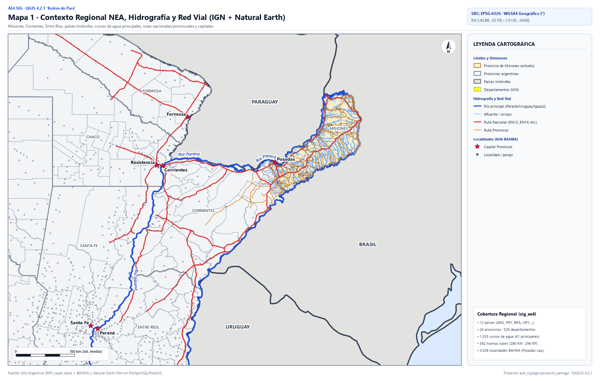

# UNIVERSIDAD DE LA CUENCA DEL PLATA
**Facultad de Ingeniería, Tecnología y Arquitectura**  
**Ingeniería en Sistemas de Información**  
**Sistemas de Información Geográfica**  
**Actividad de Evaluación 4 (AE4)**  
Sede Posadas

- **Autores:** Sánchez, Joaquín Sebastián; Núñez, Santiago Agustín
- **DNI:** 45.452.416; [Completar DNI]
- **Profesor:** Edgar Rolando Ibáñez
- **Fecha de entrega:** 21 de noviembre de 2026
- **AÑO:** 2026

---

## Índice general
1. Introducción
2. Fuentes de datos y arquitectura tecnológica
3. Fase I: Diseño e implementación de la base de datos espacial
4. Fase II: Consultas espaciales y optimización con índices GiST
5. Fase III: Interoperabilidad cliente-servidor con QGIS 4.2.1
6. Conclusiones
7. Portafolio digital
8. Índice de figuras
9. Referencias

## Índice de tablas
- **Tabla 1.** Inventario de fuentes de datos oficiales y complementarias integradas en el esquema sig_ae4
- **Tabla 2.** Estrategia dual de sistemas de referencia espacial implementada en la base de datos
- **Tabla 3.** Resumen estructural de las 19 tablas, restricciones e integridad del esquema sig_ae4
- **Tabla 4.** Resultados de la auditoría integral de validación geométrica, referencial y topológica
- **Tabla 5.** Síntesis metodológica y resultados verificados de las consultas regionales obligatorias (incisos a–i)
- **Tabla 6.** Primeras 10 intersecciones escolares sobre avenidas de mano única sin semáforo (Autoría 1)
- **Tabla 7.** Tasas de siniestralidad por condición climática, nivel de drenaje experto y origen (Autoría 2A)
- **Tabla 8.** Comparación global de corredores con obra de asfalto sobre empedrado frente al resto de la red (Autoría 2C)
- **Tabla 9.** Indicadores de equipamiento vial, población y siniestralidad en las 12 delegaciones de Posadas (Autoría 3)
- **Tabla 10.** Benchmark EXPLAIN (ANALYZE, BUFFERS) en consultas espaciales reales y trampa geom::geography
- **Tabla 11.** Escalamiento de rendimiento espacial Sin GiST vs. Con GiST hasta un millón de puntos
- **Tabla 12.** Validación cruzada 1:1 de las 21 capas del proyecto QGIS 4.2.1 frente a PostgreSQL/PostGIS
- **Tabla 13.** Síntesis de pruebas transaccionales ABM, rechazos de integridad y bloqueo concurrente MVCC

---

## 1. Introducción

El crecimiento urbano sostenido de la ciudad de Posadas, capital de la provincia de Misiones, plantea desafíos crecientes para la planificación de la infraestructura vial y la seguridad del tránsito. Entre las problemáticas operativas más urgentes se destacan la ausencia de dispositivos semafóricos en intersecciones próximas a establecimientos educativos sobre corredores de circulación rápida, la vulnerabilidad de la calzada ante precipitaciones intensas en sectores con drenaje deficiente y la desigual distribución del equipamiento de control vial entre el área céntrica y las delegaciones periféricas de expansión reciente.

Para abordar estos interrogantes con rigor geográfico, el presente proyecto de la cátedra Sistemas de Información Geográfica (Universidad de la Cuenca del Plata) implementa un sistema de base de datos espacial cliente-servidor en PostgreSQL 16.4 con PostGIS 3.4.3, acoplado directamente con QGIS 4.2.1 'Belém do Pará' y GDAL 3.13.2. La arquitectura articula dos escalas territoriales complementarias: una escala regional sobre el Nordeste Argentino (NEA), la provincia de Misiones y los países sudamericanos limítrofes a partir de servicios WFS oficiales del Instituto Geográfico Nacional (IGN), la Base de Asentamientos Humanos de la República Argentina (BAHRA) y Natural Earth 50m; y una escala urbana detallada sobre Posadas que integra capas oficiales de la Infraestructura de Datos Espaciales de Posadas (IDE Posadas), radios censales 2022 del INDEC y la red vial vectorizada de OpenStreetMap (OSM).

Por exigencia ética y metodológica de transparencia científica, el conjunto de siniestros viales incorporado en `sig_ae4.incidentes_viales` (`1.429` eventos en total) distingue estrictamente dos orígenes mediante una restricción `CHECK` y reportes desagregados en todas las consultas analíticas:

- **Relevamientos curados de prensa local (`origen = 'real'`):** `12` siniestros verificados ocurridos en Posadas entre enero y noviembre de 2026, geocodificados a partir de partes periodísticos locales y carentes de registro meteorológico en origen (`llovia IS NULL`).
- **Eventos sintéticos de demostración (`origen = 'simulado'`):** `1.417` incidentes generados para el período 2023–2025 alrededor de `7` nodos de control vial, acompañados por variable climática (`llovia` booleana, `457` bajo lluvia y `960` en tiempo seco) y su tabla de exposición horaria acumulada (`40.348` horas-nodo de lluvia y `143.612` horas-nodo secas).
- **Nodos de control vial (`nodos_control_vial`):** `7` cruces estratégicos de Posadas caracterizados mediante relevamiento experto de campo con clasificación de capacidad de drenaje pluvial (`ALTO`, `MEDIO`, `BAJO`), cantidad de carriles y presencia de semáforo, parada de ómnibus o entorno escolar.

Los objetivos específicos que estructuran este trabajo son los siguientes:

- Diseñar e implementar un esquema relacional espacial normalizado (`sig_ae4`) con criterio dual de sistemas de referencia (`EPSG:4326`, `EPSG:5348` y `geography`), restricciones topológicas y triggers automáticos de sincronización y auditoría.
- Ingestar, reparar topológicamente y validar capas vectoriales heterogéneas (GeoJSON, Shapefile con codificación `ISO-8859-1` mediante `ogr2ogr` y JSON/JSONL) garantizando cero geometrías inválidas ni registros huérfanos.
- Resolver las nueve consultas espaciales regionales obligatorias (incisos `a–i`) y tres líneas de análisis espacial de autoría orientadas a decisiones municipales de semaforización escolar, mantenimiento pluvial y equidad territorial.
- Evaluar empíricamente la optimización mediante `34` índices espaciales GiST (estándar, proyectados y funcionales sobre `geography`) a través de `EXPLAIN (ANALYZE, BUFFERS)` y curvas de escalamiento hasta `1.000.000` de puntos.
- Verificar la interoperabilidad bidireccional en vivo con QGIS 4.2.1 sin credenciales embebidas, validando operaciones ABM, rechazos `SQLSTATE` y bloqueo concurrente MVCC a nivel de fila.

A lo largo del documento se integran seis láminas técnicas y cartográficas (`Figura 1` a `Figura 6`), que abarcan el diagrama entidad-relación completo del esquema, cuatro mapas temáticos renderizados de forma nativa con PyQGIS 4.2.1 y la curva de escalamiento de índices GiST. Al cierre del informe se detallan la organización del Portafolio Digital en la sección 7, el Índice de figuras en la sección 8 y la bibliografía normalizada bajo normas APA séptima edición en la sección 9.

## 2. Fuentes de datos y arquitectura tecnológica

El entorno de ejecución se estructuró bajo la Opción A (arquitectura cliente-servidor local contenerizada): un servicio PostgreSQL `16.4` con extensión espacial PostGIS `3.4.3` (`GEOS 3.9.0`, `PROJ 7.2.1`) desplegado mediante Docker Compose en el puerto `5433` para aislarlo de eventuales instancias anfitrionas en `5432`. Esta elección garantiza reproducibilidad exacta entre equipos, persistencia transaccional MVCC real, evaluación genuina de planes de ejecución con `EXPLAIN (ANALYZE, BUFFERS)` y conexión concurrente simultánea desde clientes `psql`, Python (`psycopg2`) y QGIS Desktop `4.2.1 'Belém do Pará'` acompañado por `GDAL 3.13.2 "Iowa City"` (`ogr2ogr`).

Las capas oficiales regionales fueron descargadas directamente desde los servicios OGC WFS del IGN (`https://wms.ign.gob.ar/geoserver/ows`) y complementadas con Natural Earth 50m para los doce países soberanos sudamericanos, debido a que la capa `ign:pais` del servicio nacional solo publica el polígono de la República Argentina. A escala municipal, se consultó el GeoServer oficial de IDE Posadas (`https://www.ide.posadas.gob.ar/geoserver/ows`), enriqueciendo las `12` delegaciones municipales mediante agregación espacial de `459` radios censales del Censo 2022 (INDEC), lo que arrojó un total de `331.753` habitantes asignados dentro de los límites oficiales de delegación.

**Tabla 1.** *Inventario de fuentes de datos oficiales y complementarias integradas en el esquema sig_ae4*

| Escala | Fuente oficial / origen | Tabla destino | Formato origen | SRID | Registros |
| :--- | :--- | :--- | :--- | :---: | ---: |
| Regional | Natural Earth 50m (complemento IGN) | `paises` | GeoJSON | 4326 | 12 |
| Regional | IGN WFS (`ign:provincia`) + INDEC 2022 | `provincias` | GeoJSON | 4326 | 24 |
| Regional | IGN WFS (`ign:departamento`) + INDEC 2022 | `departamentos` | GeoJSON | 4326 | 529 |
| Regional | IGN-BAHRA WFS (`ign:localidad_bahra`) | `localidades` | GeoJSON | 4326 | 3.528 |
| Regional | IGN WFS (aguas continentales perennes) | `cursos_agua` | GeoJSON | 4326 | 1.333 |
| Regional | IGN WFS (`vial_nacional` y `vial_provincial`) | `rutas` | GeoJSON | 4326 | 582 |
| Urbana | IDE Posadas WFS + 459 radios INDEC 2022 | `delegaciones` | GeoJSON / SHP | 4326 + 5348 | 12 |
| Urbana | IDE Posadas WFS (`Intersecciones_Semaforizadas`) | `semaforos` | GeoJSON | 4326 + 5348 | 280 |
| Urbana | IDE Posadas WFS (`unidades_funcionales_educativas`) | `escuelas` | GeoJSON | 4326 + 5348 | 367 |
| Urbana | IDE Posadas WFS (`Refugios_paradas__SIG_0`) | `paradas` | GeoJSON | 4326 + 5348 | 482 |
| Urbana | IDE Posadas WFS (`manos_unicas`) | `avenidas_mano_unica` | GeoJSON | 4326 + 5348 | 8 |
| Urbana | IDE Posadas WFS (`asfalto_sobreempedrado0`) | `asfalto_sobre_empedrado` | GeoJSON | 4326 + 5348 | 613 |
| Urbana | IDE Posadas WFS (`bicisendas_ciclovias0`) | `ciclovias` | GeoJSON | 4326 + 5348 | 52 |
| Urbana | OpenStreetMap (red vial urbana Posadas) | `calles` | JSON nodos | 4326 + 5348 | 1.286 |
| Urbana | OpenStreetMap (cruces normalizados) | `intersecciones` | JSON puntos | 4326 + 5348 | 7.898 |
| Urbana | Relevamiento experto de campo (drenaje) | `nodos_control_vial` | Registro Python | 4326 + 5348 | 7 |
| Urbana | Prensa local curada + Serie sintética | `incidentes_viales` | JSONL | 4326 + 5348 | 1.429 |
| Alfanum. | Serie meteorológica horaria (2023–2025) | `exposicion_clima` | JSON | — | 2 |
| Auditoría | Triggers PL/pgSQL (`fn_auditar_edicion`) | `auditoria_ediciones` | JSONB | — | 8 |

*Nota.* En `cursos_agua` se consolidan 41 tramos principales (Río Paraná, Río Uruguay y Río Iguazú, filtrando homónimos patagónicos fuera de la Cuenca del Plata) y 1.292 afluentes en Misiones. En `rutas` se integran 286 tramos nacionales y 296 tramos provinciales. En `incidentes_viales` coexisten 12 registros `real` y 1.417 `simulado`. `auditoria_ediciones` refleja las 8 operaciones acumuladas tras las pruebas de la Fase III.

## 3. Fase I: Diseño e implementación de la base de datos espacial

### 3.1 Infraestructura y organización en esquemas

La base de datos espacial del proyecto se organiza en dos esquemas claramente separados: `staging`, destinado a la recepción cruda de geometrías y atributos desde servicios WFS y archivos Shapefile sin imponer todavía restricciones estrictas de validez o claves foráneas; y `sig_ae4`, esquema productivo compuesto por `19` tablas (`6` regionales, `11` urbanas de Posadas y `2` tablas alfanuméricas de exposición climática y auditoría). Esta separación permite aislar fallas frecuentes en datos abiertos municipales —como autointersecciones o codificaciones heredadas— y ejecutar su saneamiento declarativo en SQL antes de poblar las tablas de producción.

### 3.2 Estrategia de sistemas de referencia

Un aspecto crítico en el diseño de bases de datos espaciales multiescala radica en evitar tanto la medición euclidiana directa sobre coordenadas angulares (`EPSG:4326`) como la distorsión cartográfica al extender una única faja plana sobre todo un país o continente. A latitud de Posadas (`-27,37°`), un grado de longitud equivale a aproximadamente `98,9 km` mientras un grado de latitud mide `110,8 km`, por lo que operar distancias o buffers en grados introduciría errores sistemáticos cercanos al `11%` y anisotropía direccional.

En consecuencia, se adoptó una arquitectura de referencia dual para Posadas y un criterio geodésico elipsoidal para la escala regional. Para el ámbito urbano de Posadas (`longitud ≈ -55,9°`), se seleccionó `EPSG:5348` (*POSGAR 2007 / Argentina Faja 6*), cuya proyección Transverse Mercator utiliza meridiano central `57° O`, elipsoide GRS80 y falso este de `6.500.000 m`. Frente a la Faja 7 (`EPSG:5349`, meridiano central `54° O`), que cubre el noreste misionero (como Bernardo de Irigoyen a `-53,6°`), la Faja 6 abarca íntegramente el área metropolitana capitalina a solo `1,1°` de su meridiano central, minimizando el factor de escala lineal. La columna `geom_m` en `EPSG:5348` se sincroniza de forma transparente mediante el trigger `trg_01_sync_geom_m` cada vez que un cliente inserta o modifica `geom` en `EPSG:4326`.

**Tabla 2.** *Estrategia dual de sistemas de referencia espacial implementada en la base de datos*

| Sistema / Tipo | Alcance en sig_ae4 | Unidades | Justificación técnica y mecanismo de mantenimiento |
| :--- | :--- | :---: | :--- |
| `EPSG:4326` (WGS 84 geográfico) | Columna `geom` en las 17 tablas espaciales | Grados decimales | Estándar universal de intercambio WFS/GeoJSON y visualización directa en QGIS; mantiene compatibilidad nativa con fuentes IGN e IDE Posadas. |
| `EPSG:5348` (POSGAR 2007 / Argentina Faja 6) | Columna `geom_m` en las 11 tablas urbanas | Metros planos | Meridiano central 57° O óptimo para Posadas (-55,9° O). Sincronizada automáticamente `BEFORE INSERT OR UPDATE OF geom` por `trg_01_sync_geom_m`. |
| `geography` (WGS 84 esferoidal) | Consultas regionales `a–i` sobre `geom::geography` | Metros sobre elipsoide | Argentina abarca 7 fajas POSGAR (4343–4349) y Sudamérica supera cualquier proyección plana local. Acelerada mediante índices GiST funcionales. |

*Nota.* Elaboración propia a partir de la definición DDL en `00_init.sql` y el estándar POSGAR 2007 del Instituto Geográfico Nacional.

### 3.3 Modelo relacional espacial, restricciones e integridad

Las `19` tablas de `sig_ae4` utilizan claves primarias `INTEGER GENERATED ALWAYS AS IDENTITY` para permitir que QGIS genere identificadores únicos de forma automática en sesiones de edición sin colisiones. Las `17` tablas con geometría incorporan `NOT NULL CHECK (ST_IsValid(geom))`, además de restricciones de dominio explícitas sobre `origen` (`'real'`, `'simulado'`), `severidad` (`1..5`), `jurisdiccion` (`'nacional'`, `'provincial'`), `nivel_drenaje` (`'ALTO'`, `'MEDIO'`, `'BAJO'`) y la unicidad compuesta `uq_intersecciones_par (calle_1_norm, calle_2_norm)` en `intersecciones`.

El comportamiento reactivo de la base de datos se apoya en tres funciones PL/pgSQL: `fn_sync_geom_m()`, adjunta como `trg_01_sync_geom_m` en las `11` tablas urbanas; `fn_sync_incidente_nodos()`, adjunta como `trg_02_sync_incidente_nodos` en `incidentes_viales` (aprovechando el orden alfabético de triggers en PostgreSQL para ejecutarse inmediatamente después de `trg_01_sync_geom_m` y enlazar cada siniestro con la intersección OSM más cercana dentro de `150 m` y el nodo de control vial más cercano dentro de `500 m`); y `fn_auditar_edicion()`, que registra toda operación `INSERT`, `UPDATE` o `DELETE` sobre `semaforos` e `incidentes_viales` en `auditoria_ediciones` mediante un objeto `JSONB` con los estados anterior y nuevo.


**Figura 1.** *Modelo entidad-relación espacial completo del esquema sig_ae4.* Incluye las 19 tablas distribuidas en escala regional, escala urbana y analítica/auditoría, claves primarias y foráneas, restricciones CHECK, dualidad SRID (4326/5348) y triggers. Elaboración propia.

**Tabla 3.** *Resumen estructural de las 19 tablas, restricciones e integridad del esquema sig_ae4*

| Tabla (`sig_ae4`) | Geometría / SRID | Claves y restricciones principales | Triggers / Rol en el modelo |
| :--- | :--- | :--- | :--- |
| `paises` | MultiPolygon (4326) | PK `id`, UQ `codigo_iso3`, CHK `ST_IsValid`, `poblacion>=0` | Nivel raíz geopolítico sudamericano |
| `provincias` | MultiPolygon (4326) | PK `id`, UQ `codigo_indec`, FK `pais_id`, CHK `ST_IsValid` | 24 jurisdicciones argentinas + región |
| `departamentos` | MultiPolygon (4326) | PK `id`, UQ `codigo_indec`, FK `provincia_id`, CHK `ST_IsValid` | 529 divisiones de segundo orden |
| `localidades` | Point (4326) | PK `id`, UQ `codigo_bahra`, FK `departamento_id`, CHK `ST_IsValid` | Marcas capital nacional y provincial |
| `cursos_agua` | MultiLineString (4326) | PK `id`, UQ `id_origen`, `es_principal`, CHK `ST_IsValid` | Ríos principales y afluentes misioneros |
| `rutas` | MultiLineString (4326) | PK `id`, UQ `id_origen`, CHK `jurisdiccion`, `ST_IsValid` | Red troncal nacional y provincial |
| `delegaciones` | MultiPolygon (4326/5348) | PK `id`, UQ `id_ide`, CHK `poblacion_2022>=0`, `ST_IsValid` | `trg_01_sync_geom_m`; 12 polígonos |
| `semaforos` | Point (4326/5348) | PK `id`, UQ `id_ide`, CHK `ST_IsValid` | `trg_01_sync_geom_m`, `trg_auditar_semaforos` |
| `escuelas` | Point (4326/5348) | PK `id`, UQ `id_ide`, CHK `ST_IsValid` | `trg_01_sync_geom_m`; gestión estatal/priv. |
| `paradas` | Point (4326/5348) | PK `id`, UQ `id_ide`, CHK `ST_IsValid` | `trg_01_sync_geom_m`; refugios transporte |
| `avenidas_mano_unica` | MultiLineString (4326/5348) | PK `id`, UQ `id_ide`, CHK `ST_IsValid` | `trg_01_sync_geom_m`; 8 corredores |
| `asfalto_sobre_empedrado` | MultiLineString (4326/5348) | PK `id`, UQ `id_ide`, CHK `ST_IsValid` | `trg_01_sync_geom_m`; obras viales |
| `ciclovias` | MultiLineString (4326/5348) | PK `id`, UQ `id_ide`, CHK `ST_IsValid` | `trg_01_sync_geom_m`; movilidad activa |
| `calles` | MultiLineString (4326/5348) | PK `id`, UQ `osm_id`, UQ `nombre_normalizado`, CHK `ST_IsValid` | `trg_01_sync_geom_m`; red OSM limpia |
| `nodos_control_vial` | Point (4326/5348) | PK `id`, UQ `node_id`, CHK `lanes>0`, `nivel_drenaje` | `trg_01_sync_geom_m`; 7 nodos expertos |
| `intersecciones` | Point (4326/5348) | PK `id`, UQ `(calle_1_norm, calle_2_norm)`, CHK `subtipo` | `trg_01_sync_geom_m`; nodos y rotondas |
| `incidentes_viales` | Point (4326/5348) | PK `id`, UQ `id_origen`, CHK `origen`, `severidad 1..5`, 2 FKs | `trg_01`, `trg_02_sync_incidente_nodos`, auditoría |
| `exposicion_clima` | Alfanumérica | PK `id`, UQ `condicion` (`lluvia`/`seco`), col. `GENERATED` | Denominador horario de tasas climáticas |
| `auditoria_ediciones` | Alfanumérica (`JSONB`) | PK `id`, CHK `operacion` (`INSERT`/`UPDATE`/`DELETE`) | Bitácora inmutable de cambios DML |

*Nota.* Las 19 claves primarias utilizan `GENERATED ALWAYS AS IDENTITY` para compatibilidad transaccional con QGIS Desktop. En `exposicion_clima`, la columna `horas_por_nodo` se calcula automáticamente como columna generada almacenada (`horas_nodo_totales / 7`).

### 3.4 Carga, reparación topológica y validación

El flujo de ingesta se ejecutó en dos etapas reproducibles (`staging` hacia `sig_ae4`). Durante la validación de herramientas externas de ingesta vectorial, se ejecutó en vivo `GDAL 3.13.2 "Iowa City"` (`ogr2ogr.exe`) leyendo directamente desde el archivo comprimido oficial de delegaciones mediante el controlador virtual `/vsizip/` con la variable `SHAPE_ENCODING=ISO-8859-1` para preservar acentos y eñes del formato DBF (`Itaembé Guazú`, `Itaembé Miní Oeste`). La carga en `staging.ide_delegaciones_ogr_demo` finalizó con código de salida `0` e insertó `12` entidades `MULTIPOLYGON` en `EPSG:4326`, pero la inspección inmediata en PostGIS reveló `todas_validas = f` (`false`), detectándose dos autointersecciones puntuales en el dato crudo municipal (`[-55.934457, -27.352682]` y `[-55.891561, -27.408794]`).

Este hallazgo empírico confirmó la necesidad de aplicar en la normalización SQL (`01_cargar_staging_a_final.sql`) la cadena `ST_Multi(ST_CollectionExtract(ST_MakeValid(ST_Force2D(geom)), 3))` antes de insertar en tablas productivas protegidas por `CHECK (ST_IsValid(geom))`. De manera análoga, en la reconstrucción de las `1.286` calles de OpenStreetMap desde vértices no ordenados, el módulo Python de carga encadenó los nodos por vecino más cercano cortando en sub-tramos separados cada vez que el salto supera `300 m`, evitando líneas artificiales que atraviesen manzanas en arterias discontinuas.

```sql
-- Normalización y reparación topológica staging -> sig_ae4 (delegaciones)
INSERT INTO sig_ae4.delegaciones
  (id_ide, nombre, poblacion_2022, geom, geom_m)
SELECT dc.id_ide, dc.nombre, COALESCE(SUM(rp.poblacion_n), 0)::INTEGER,
       dc.geom, ST_Transform(dc.geom, 5348)
FROM (
  SELECT REPLACE(TRIM(d.id_ide), 'DELEGACIONES_MUNICIPALES_POSADAS_',
                 'DELEG_POSADAS_') AS id_ide,
         COALESCE(NULLIF(TRIM(d.nombre), ''), TRIM(d.id_ide)) AS nombre,
         ST_Multi(ST_CollectionExtract(ST_MakeValid(ST_Force2D(
           ST_SetSRID(ST_GeomFromGeoJSON(d.geom_json), 4326))), 3)) AS geom
  FROM staging.ide_delegaciones d
) dc
LEFT JOIN radios_pts rp ON ST_Within(rp.pt, dc.geom)
GROUP BY dc.id_ide, dc.nombre, dc.geom;
```

**Tabla 4.** *Resultados de la auditoría integral de validación geométrica, referencial y topológica*

| Control ejecutado (`01_validacion.sql`) | Alcance evaluado | Resultado observado | Estado |
| :--- | :--- | :--- | :---: |
| Validez geométrica (`ST_IsValid`) y no nulidad | 17 tablas espaciales (`17.643` filas) | `0` geometrías nulas; `0` inválidas | OK |
| Integridad de SRID (`geom` y `geom_m`) | 17 tablas `4326` + 11 urbanas `5348` | `0` errores SRID en `4326`; `0` en `5348` | OK |
| Integridad referencial (5 relaciones FK) | Jerarquía IGN + vínculos de incidentes | `0` registros huérfanos | OK |
| Trigger `trg_02_sync_incidente_nodos` (`real`) | `12` incidentes reales | `11` con intersección (`91,7%`); `4` con nodo (`33,3%`) | OK |
| Trigger `trg_02_sync_incidente_nodos` (`simulado`) | `1.417` incidentes simulados | `1.417` con intersección y nodo (`100,0%`) | OK |
| Total vinculado en `incidentes_viales` | `1.429` incidentes totales | `1.428` (`99,9%`) intersec.; `1.421` (`99,4%`) nodo | OK |
| Sanity check 4A: Capitales nacionales/prov. | `localidades` BAHRA | `1` cap. nacional + `23` provinciales = `24` | OK |
| Sanity check 4B: Vecindad de países NE 50m | `12` países sudamericanos | `ST_Touches = ST_Intersects` (`0` solapes) | OK |
| Sanity check 4C: Vecindad provincial IGN | `24` provincias argentinas | Misiones limita solo con Corrientes (`ST_Touches`) | OK |
| Sanity check 4D: Ríos principales en Misiones | Paraná (`39`), Uruguay (`1`), Iguazú (`1`) | `16` intersecciones dpto.-río consistentes | OK |

*Nota.* Los valores corresponden íntegramente a la ejecución verificada de `sql/01_validacion.sql` registrada en `outputs/validacion_resultados.txt`. El único incidente real sin intersección OSM a `<= 150 m` corresponde a `Av. Alicia Moreau de Justo (Ex Ruta 213)`.

## 4. Fase II: Consultas espaciales y optimización con índices GiST

### 4.1 Consultas obligatorias — Escala regional (incisos a–i)

Las nueve consultas obligatorias sobre la escala regional (`02_consultas_a_i.sql`) se formularon empleando aritmética esferoidal `geography` sobre `geom` (`EPSG:4326`) y unificando previamente los ríos multi-tramo mediante `ST_Union` para evitar dobles conteos al cruzar contra departamentos y países. De este modo se resolvió la integración jerárquica completa de las `3.528` localidades BAHRA (`140` en Misiones), las `24` capitales administrativas, las estadísticas geodésicas de área y densidad de los `12` países sudamericanos (`Brasil` `8.467.129,34 km²` y `Argentina` `2.782.471,64 km²`) y de los `17` departamentos misioneros (contrastando `Capital` con `407,39 hab/km²` en `964,48 km²` frente a `San Pedro` con `3.818,06 km²` y `9,11 hab/km²`).

El contraste topológico entre `ST_Touches` y `ST_Intersects` en el inciso `d` aportó un diagnóstico relevante sobre la calidad geométrica de los polígonos oficiales. Mientras los `12` países de Natural Earth 50m exhibieron coincidencia exacta entre ambos predicados (`diff_micro_overlap = 0` en los `12` casos), en la capa provincial del IGN (`24` entidades) se identificaron `4` pares fronterizos donde `ST_Intersects` resulta verdadero pero `ST_Touches` devuelve falso: `Entre Ríos–Corrientes` (`5,29 m²`), `Buenos Aires–Entre Ríos` (`4,77 m²`), `San Juan–La Rioja` (`0,03 m²`) y `Jujuy–Salta` (`< 0,005 m²`, redondeado a `0,00 m²`). Según el modelo DE-9IM, `ST_Touches(A, B)` exige que la intersección afecte únicamente a las fronteras con interiores estrictamente disjuntos (`I(A) ∩ I(B) = ∅`). Estos cuatro micro-solapamientos bidimensionales (`ST_Dimension = 2`, `ST_Overlaps = true`), aunque inferiores a `6 m²` en escala continental, alcanzan para invalidar la adyacencia estricta por `ST_Touches` (haciendo figurar a Jujuy con `0` vecinos y a Entre Ríos con `1` en lugar de `3`).

Desde la perspectiva territorial del transporte, los incisos `e–i` cuantifican las barreras hidrográficas y la accesibilidad vial de Misiones (`Figura 2`). Los tres cursos principales totalizan `715,645 km` de ribera en la provincia (`Río Uruguay` `336,989 km` en `7` departamentos, `Río Paraná` `246,439 km` en `7` departamentos y `Río Iguazú` `132,217 km` en `2` departamentos). La localidad misionera más distante del Río Paraná es `Bernardo de Irigoyen` (`97,266 km`), seguida por `Alicia Baja` (`94,259 km`) y `El Soberbio` (`92,677 km`), por lo que el `100,00%` de las `140` localidades misioneras y `1.156` localidades de `9` jurisdicciones argentinas se sitúan dentro de la franja de `200 km` del Paraná. En accesibilidad troncal mediante `CROSS JOIN LATERAL` y operador KNN `<->`, `67` localidades misioneras tienen como corredor más próximo la **RN 12** (`4,415 km` promedio, máx. `20,678 km`), `66` la **RN 14** (`14,728 km` promedio, máx. `50,258 km` en `Alicia Baja`) y `7` la **RN 101** (`5,727 km` promedio, máx. `15,811 km`).



**Figura 2.** *Contexto regional del Nordeste Argentino, hidrografía principal y red vial troncal.* Integración en PostGIS de capas IGN WFS, localidades BAHRA y países Natural Earth 50m renderizada en QGIS 4.2.1. Elaboración propia.

**Tabla 5.** *Síntesis metodológica y resultados verificados de las consultas regionales obligatorias (incisos a–i)*

| Inciso | Objetivo analítico | Operadores / funciones PostGIS | Resultados clave verificados |
| :---: | :--- | :--- | :--- |
| `a` | Unión relacional localidad → país | `JOIN` jerárquico (4 tablas) | Muestra nacional (`50` filas) + `140` localidades completas de Misiones en `17` departamentos. |
| `b` | Jerarquía de capitales | `CASE`, `JOIN`, filtros booleanos | `24` capitales (`1` nacional: Ciudad de Buenos Aires; `23` provinciales, incluida Posadas). |
| `c` | Superficie y densidad poblacional | `ST_Area(geom::geography)` / 1e6 | `12` países (Brasil `8,47M km²`, Arg. `2,78M km²`) y `17` deptos. Misiones (Capital `407,39 hab/km²`). |
| `d` | Adyacencia y fronteras | `ST_Touches` vs `ST_Intersects` | Países `0` discrepancias (`BR=9, AR=5`); provincias `4` micro-solapes IGN (`0,00–5,29 m²`). |
| `e` | Overlays ríos vs. jurisdicciones | `ST_Union`, `ST_Intersects` | Paraná y Uruguay cruzan `7` deptos. c/u; Iguazú `2`. Uruguay atraviesa `3` países. |
| `f` | Longitud segmentada de ríos | `ST_Length(geography)`, `ST_CollectionExtract`, `ST_Intersection(..., 2)` | En Misiones: Uruguay `336,989 km`, Paraná `246,439 km`, Iguazú `132,217 km` (total `1.845,290 km` Paraná). |
| `g` | Alejamiento extremo al Paraná | `ST_Distance(geography)` | `Bernardo de Irigoyen` es la más alejada (`97,266 km`), seguida por `Alicia Baja` (`94,259 km`). |
| `h` | Accesibilidad a rutas nacionales | `CROSS JOIN LATERAL` + `<->` + `ST_Distance` | `RN 12`: `67` loc. (`4,415 km` prom.); `RN 14`: `66` (`14,728 km` prom.); `RN 101`: `7` (`5,727 km` prom.). |
| `i` | Localidades `< 200 km` del Paraná | `ST_DWithin(geography)` (200 km) | `140` localidades en Misiones (`100%`) y `1.156` en `9` provincias argentinas. |

*Nota.* Datos obtenidos directamente de `outputs/consultas_a_i_resultados.txt` ejecutado mediante `sql/02_consultas_a_i.sql`. Las distancias y áreas se evaluaron en sistema esferoidal WGS84 (`geography`).

### 4.2 Consultas de autoría — Escala urbana de Posadas

Las consultas de autoría propias (`03_consultas_autoria.sql`) operan íntegramente en unidades métricas planas (`geom_m`, `EPSG:5348`) y exponen identificadores únicos `id` junto con `geom` (`EPSG:4326`) para su consumo directo como capas SQL en QGIS. En todas las agregaciones de siniestralidad se mantiene una separación estricta entre eventos `real` y `simulado`.

#### 4.2.1 Incorporación de semaforización en zona escolar (Autoría 1)

El problema abordado consiste en localizar intersecciones viales de OpenStreetMap que se encuentren simultáneamente a `<= 150 m` de al menos una unidad educativa oficial de IDE Posadas y a `<= 25 m` de una avenida de mano única (corredores de flujo continuo y mayor velocidad operativa), pero que carezcan de semáforo oficial dentro de un radio de exclusión de `30 m` (`NOT EXISTS` con `ST_DWithin`). El cruce espacial identificó exactamente **`104` intersecciones candidatas** (`56` asociadas a establecimientos de gestión estatal y `48` a gestión privada).

Al evaluar la siniestralidad en dos radios complementarios (`50 m` en horarios pico escolares de entrada/salida frente a `250 m` sobre el corredor), ninguna de las `104` esquinas candidatas registró eventos en `50 m`, pero las primeras tres intersecciones concentran coincidencia con `1` siniestro real y entre `117` y `214` eventos simulados en el radio de corredor de `250 m`: **Beethoven y Avenida Centenario** (`C.F.P. Nº 16`, `52,9 m`), **Avenida Centenario y Derqui** (`E.P.E.T. Nº 01: "UNESCO"`, `136,3 m`) y **Avenida Lavalle y Neumann** (`E.P.E.T. Nº 01: "UNESCO"`, `21,4 m`). Esta evidencia respalda la decisión municipal de priorizar la instalación de nuevos semáforos, sendas peatonales elevadas o asignación de inspectores escolares sobre los ejes de Av. Centenario y Av. Lavalle en las inmediaciones de la E.P.E.T. Nº 1 (`Figura 3`).

```sql
-- Autoría 1: Intersecciones escolares en av. mano única sin semáforo
SELECT i.id, i.nombre, esc.escuela_cercana, esc.dist_escuela_m,
       ave.avenida_mano_unica, stats.siniestros_corredor_250m_real,
       stats.siniestros_corredor_250m_simulado, i.geom
FROM sig_ae4.intersecciones i
JOIN LATERAL (
  SELECT e.nombre AS escuela_cercana,
         ROUND(ST_Distance(i.geom_m, e.geom_m)::numeric, 1) AS dist_escuela_m
  FROM sig_ae4.escuelas e
  WHERE ST_DWithin(i.geom_m, e.geom_m, 150.0)
  ORDER BY i.geom_m <-> e.geom_m LIMIT 1
) esc ON TRUE
JOIN LATERAL (
  SELECT a.nombre AS avenida_mano_unica
  FROM sig_ae4.avenidas_mano_unica a
  WHERE ST_DWithin(i.geom_m, a.geom_m, 25.0)
  ORDER BY i.geom_m <-> a.geom_m LIMIT 1
) ave ON TRUE
WHERE NOT EXISTS (
  SELECT 1 FROM sig_ae4.semaforos s
  WHERE ST_DWithin(i.geom_m, s.geom_m, 30.0)
);
```

**Tabla 6.** *Primeras 10 intersecciones escolares sobre avenidas de mano única sin semáforo (Autoría 1)*

| Intersección candidata (OSM) | Escuela cercana (IDE) | Sector | Dist. (m) | Avenida mano única | 250 m (R/S) |
| :--- | :--- | :---: | ---: | :--- | :---: |
| Beethoven y Avenida Centenario | C.F.P. Nº 16 | Estatal | 52,9 | AV. CENTENARIO | 1 / 214 |
| Avenida Centenario y Derqui | E.P.E.T. Nº 01: "UNESCO" | Estatal | 136,3 | AV. CENTENARIO | 1 / 214 |
| Avenida Lavalle y Neumann | E.P.E.T. Nº 01: "UNESCO" | Estatal | 21,4 | AV. LAVALLE | 1 / 117 |
| Gobernador Bermúdez y Av. Tambor de Tacuarí | BACH. HUMANISTA "MONS. J. KEMERER" | Privado | 142,8 | AV. TAMBOR DE TACUARÍ | 0 / 9 |
| Pasaje Labat y Avenida Lavalle | GUARDERIA "CASA DEL NIÑO" I.P.S. 9001 | Estatal | 17,8 | AV. LAVALLE | 0 / 0 |
| Avenida Kolping y Av. Tambor de Tacuarí | INST. SUPERIOR "VERBO DIVINO" | Privado | 20,4 | AV. TAMBOR DE TACUARÍ | 0 / 0 |
| Avenida Santa Catalina y Suecia | INST. ADVENTISTA ALTA GRACIA | Privado | 21,3 | AV. SANTA CATALINA | 0 / 0 |
| Calle 96 y Avenida Santa Catalina | INST. POLITECNICO SAN ARNOLDO JANSSEN | Privado | 22,1 | AV. SANTA CATALINA | 0 / 0 |
| Cucchiaroni y Av. Tambor de Tacuarí | CEMU Nº 01 | Estatal | 22,1 | AV. TAMBOR DE TACUARÍ | 0 / 0 |
| Carola Lorenzini y Av. Ramón Martirenez | INST. CRISTIANO EMANUEL | Privado | 23,0 | AV. FRANCISCO DE HARO | 0 / 0 |

*Nota.* Subconjunto ordenado de las 104 candidatas totales (56 estatales y 48 privadas). La columna `250 m (R/S)` indica siniestros reales (`R`) y simulados (`S`) en un corredor de 250 m. Todas las filas registraron 0 eventos en el radio estricto de 50 m.


**Figura 3.** *Mapa de las 104 intersecciones escolares en avenidas de mano única sin semáforo.* Destaca las tres intersecciones críticas con siniestralidad real en corredor de 250 m sobre Av. Centenario y Av. Lavalle. Elaboración propia.

#### 4.2.2 Mantenimiento preventivo y sensibilidad climática (Autoría 2)

La segunda línea analítica se desdobla en tres consultas complementarias orientadas al mantenimiento pluvial y de calzada. La Parte 2A cruza los incidentes viales con los `7` nodos de control vial clasificados según capacidad de drenaje experto (`ALTO`, `MEDIO`, `BAJO`) y normaliza los conteos por las horas de exposición climática registradas en `exposicion_clima` (`5.764,00` horas de lluvia y `20.516,00` horas secas por nodo en el trienio 2023–2025). Como se observa en la Tabla 7, en el subconjunto simulado la razón de riesgo lluvia frente a condición seca alcanza **`1,74×`** tanto en drenaje `BAJO` (`11,046` vs `6,337` eventos cada `1.000` h-nodo) como en drenaje `MEDIO` (`11,624` vs `6,678`), frente a **`1,59×`** en drenaje `ALTO` (`11,450` vs `7,214`). Por su parte, los `4` incidentes reales localizados a `<= 500 m` de estos nodos presentan `llovia IS NULL`, por lo cual sus tasas climáticas permanecen en cero y las inferencias causales sobre lluvia quedan explícitamente acotadas al subconjunto sintético.

**Tabla 7.** *Tasas de siniestralidad por condición climática, nivel de drenaje experto y origen (Autoría 2A)*

| Drenaje | Origen | Nodos | Total | Lluvia | Seco | Sin dato | Tasa lluvia /1000h | Tasa seco /1000h | Razón riesgo |
| :---: | :---: | ---: | ---: | ---: | ---: | ---: | ---: | ---: | :---: |
| BAJO | `real` | 3 | 1 | 0 | 0 | 1 | 0,000 | 0,000 | — |
| MEDIO | `real` | 2 | 2 | 0 | 0 | 2 | 0,000 | 0,000 | — |
| ALTO | `real` | 2 | 1 | 0 | 0 | 1 | 0,000 | 0,000 | — |
| BAJO | `simulado` | 3 | 581 | 191 | 390 | 0 | 11,046 | 6,337 | 1,74× |
| MEDIO | `simulado` | 2 | 408 | 134 | 274 | 0 | 11,624 | 6,678 | 1,74× |
| ALTO | `simulado` | 2 | 428 | 132 | 296 | 0 | 11,450 | 7,214 | 1,59× |

*Nota.* Exposición acumulada por nivel: `17.292,00` h lluvia y `61.548,00` h seco en `BAJO` (3 nodos); `11.528,00` h lluvia y `41.032,00` h seco en `MEDIO` y `ALTO` (2 nodos c/u). Severidad promedio en simulados: `1,39/1,39` (`BAJO`), `1,46/1,44` (`MEDIO`), `1,41/1,41` (`ALTO`).

En forma complementaria, la Parte 2B identifica las `30` calles OSM con mayor concentración y severidad en lluvia dentro de un buffer de `40 m`, encabezadas por **Avenida San Martín** (`6,83 km`, `1` real y `402` simulados, `130` en lluvia, puntaje `57,89`), **Berón de Astrada** (`33,36`), **Avenida Lavalle** (`33,36`), **Carola Lorenzini** (`31,21`) y **Uruguay** (`30,68`). Para evitar sesgos de muestreo al comparar infraestructura repavimentada, la Parte 2C evalúa las `1.286` calles completas de la red según intersecten en `<= 25 m` obras IDE de `asfalto_sobre_empedrado` (`Tabla 8`). Se verifica que las `552` arterias con obra (`1.019,30 km`) concentran el flujo troncal y presentan una razón relativa simulada lluvia/seco de **`1,66×`** (`31,8%` en lluvia), inferior al **`1,82×`** (`33,8%` en lluvia) observado en las `734` calles sin repavimentación (`527,00 km`). Estos resultados orientan al área de obras públicas a programar limpieza preventiva de sumideros en corredores troncales de drenaje `BAJO` y extender la repavimentación asfáltica en ejes secundarios con mayor sensibilidad húmeda.

**Tabla 8.** *Comparación global de corredores con obra de asfalto sobre empedrado frente al resto de la red (Autoría 2C)*

| Obra asfalto s/empedrado | Calles | Long. (km) | Reales | Sim. lluvia | Sim. seco | Totales | Sim. lluvia/km | % lluvia sim. | Razón L/S |
| :--- | ---: | ---: | ---: | ---: | ---: | ---: | ---: | ---: | :---: |
| Sí (`<= 25 m`) | 552 | 1.019,30 | 18 | 926 | 1.987 | 2.931 | 0,91 | 31,8% | 1,66× |
| No | 734 | 527,00 | 5 | 71 | 139 | 215 | 0,13 | 33,8% | 1,82× |

*Nota.* Un incidente cercano a una esquina puede computarse dentro del buffer de 40 m de más de una calle concurrente, por lo que las razones lluvia/seco (`1,66×` vs `1,82×`) deben interpretarse de forma relativa entre ambos conjuntos de corredores. Severidad promedio simulada (lluvia/seco): `1,42/1,41` con obra y `1,35/1,44` sin obra.

#### 4.2.3 Brecha de equipamiento por delegación municipal (Autoría 3)

La tercera consulta de autoría evalúa la equidad territorial entre las `12` delegaciones municipales de Posadas contrastando su stock real de equipamiento (semáforos IDE, paradas con refugio, establecimientos educativos e intersecciones OSM) contra la carga demográfica 2022 y la densidad de siniestralidad. Para sintetizar la prioridad de inversión vial se definió el indicador compuesto transparente `indice_brecha_prioridad`:

```sql
indice_brecha_prioridad =
  ((siniestros_real * 3.0 + siniestros_simulado) / area_km2)
  * (1.0 / (1.0 + (semaforos_cada_100_intersecciones / 10.0)))
```

Esta métrica pondera tres veces los siniestros reales observados respecto a los simulados por unidad de superficie y atenúa el puntaje conforme crece la densidad de semaforización. Los resultados completos (`Tabla 9` y `Figura 4`) revelan dos brechas diferenciadas. Por un lado, un fuerte contraste de cobertura real: mientras **Sede Central** (`1,93 km²`) concentra `74` semáforos (`44,31` cada `100` intersecciones), delegaciones periféricas en expansión como **Itaembé Guazú** (`663` intersecciones, `16.993` habitantes, `10` escuelas) e **Itaembé Miní Este** (`462` intersecciones, `20.573` habitantes, `12` escuelas) registran **`0,00` semáforos oficiales**, y **Dolores Sur** dispone apenas de `1` semáforo (`0,22` cada `100` intersecciones). Por otro lado, el índice compuesto alcanza sus máximos en **32-33** (`51,82`, con `4,22` semáforos/100 int. y `2` reales) y **Riberas del Paraná** (`49,27`, con `2,15` semáforos/100 int.), mientras **Villa Urquiza** encabeza la siniestralidad real (`4` siniestros reales, índice `20,60`). Esta evidencia respalda una asignación dual del presupuesto municipal: reforzar semaforización y refugios en las delegaciones periféricas desprovistas y ejecutar pacificación vial en 32-33, Riberas del Paraná y Villa Urquiza.

**Tabla 9.** *Indicadores de equipamiento vial, población y siniestralidad en las 12 delegaciones de Posadas (Autoría 3)*

| Delegación | Área km² | Pob. 2022 | Inters. | Sem. | Sem/100 | Par. | Esc. | Real | Sim. | Brecha |
| :--- | ---: | ---: | ---: | ---: | ---: | ---: | ---: | ---: | ---: | ---: |
| Sede Central | 1,93 | 14.911 | 167 | 74 | 44,31 | 44 | 68 | 2 | 67 | 6,96 |
| Villa Urquiza | 6,41 | 34.203 | 630 | 30 | 4,76 | 61 | 49 | 4 | 183 | 20,60 |
| 32-33 | 5,54 | 26.117 | 592 | 25 | 4,22 | 46 | 26 | 2 | 402 | 51,82 |
| Riberas del Paraná | 6,82 | 29.005 | 512 | 11 | 2,15 | 38 | 22 | 1 | 405 | 49,27 |
| Villa Cabello | 7,90 | 47.379 | 781 | 31 | 3,97 | 71 | 52 | 1 | 0 | 0,27 |
| Santa Rita | 8,25 | 34.784 | 755 | 18 | 2,38 | 37 | 24 | 1 | 133 | 13,30 |
| Itaembé Guazú | 39,06 | 16.993 | 663 | 0 | 0,00 | 18 | 10 | 0 | 0 | 0,00 |
| Itaembé Miní Este | 7,42 | 20.573 | 462 | 0 | 0,00 | 18 | 12 | 0 | 0 | 0,00 |
| Dolores Sur | 74,94 | 29.015 | 454 | 1 | 0,22 | 37 | 35 | 0 | 0 | 0,00 |
| Itaembé Miní Oeste | 94,52 | 21.652 | 456 | 5 | 1,10 | 27 | 14 | 0 | 0 | 0,00 |
| Dolores Norte | 5,96 | 25.835 | 464 | 6 | 1,29 | 21 | 18 | 0 | 0 | 0,00 |
| Miguel Lanús | 10,69 | 31.286 | 560 | 13 | 2,32 | 25 | 29 | 0 | 0 | 0,00 |

*Nota.* Totales contenidos dentro de los polígonos de delegación: `269,44 km²`, `331.753` habitantes, `6.496` intersecciones, `214` semáforos, `443` paradas, `359` escuelas, `11` siniestros reales y `1.190` simulados (`1` incidente real sobre Ex Ruta 213 y `227` simulados en bordes costeros/arteriales yacen fuera del límite oficial de delegación).


**Figura 4.** *Coroplético de cobertura semafórica cada 100 intersecciones y siniestros reales por delegación.* Contrasta el centro urbano semaforizado frente al déficit de Itaembé Guazú e Itaembé Miní Este. Elaboración propia.

### 4.3 Optimización mediante índices espaciales GiST

Las estructuras tradicionales **B-tree** organizan claves unidimensionales bajo orden total (`<`, `=`, `>`), por lo que sirven eficazmente para claves primarias, fechas (`fecha_evento`) y filtros exactos (`origen`), pero resultan incapaces de acelerar predicados bidimensionales porque la linealización de coordenadas `(X, Y)` destruye la localidad espacial. Para resolver búsquedas de solapamiento, contención y vecindad, PostGIS implementa sobre **GiST** (*Generalized Search Tree*) una estructura **R-Tree** (Guttman, 1984) que encapsula cada geometría en su Rectángulo Mínimo Envolvente (*MBR*, `box2df`). Los nodos internos almacenan pares `(MBR_envolvente, puntero)` y las hojas almacenan `(MBR_geometría, TID)` apuntando a la página física del *heap*.

Toda consulta espacial indexada opera en dos fases: primero, un **filtro grueso** (*lossy*) mediante el operador de cajas `&&` (inyectado internamente por `ST_Intersects`, `ST_Within` y `ST_DWithin`) o `<->` para búsquedas KNN por cola de prioridad; segundo, un **refinamiento exacto** (*recheck*) ejecutado por GEOS vértice por vértice únicamente sobre las tuplas candidatas. Frente a alternativas como **SP-GiST** (particiones disjuntas como Quadtree/k-d tree, ventajosas en nubes masivas homogéneas de puntos) o **BRIN** (resúmenes por bloques físicos contiguos que pierden selectividad cuando la tabla no está clusterizada espacialmente), GiST ofrece soporte unificado para puntos, líneas y polígonos heterogéneos, además de ordenamiento KNN nativo.

Se crearon **`34` índices GiST** (`1.928 kB` acumulados en `sig_ae4`): `22` en las `11` tablas urbanas (`geom` y `geom_m`) y `12` en las `6` tablas regionales (`geom` más índices funcionales `USING GIST ((geom::geography))`). La creación del índice funcional responde a una trampa clásica de PostGIS: cuando una consulta sobre una columna `geometry(4326)` aplica un casteo `geom::geography` en tiempo de ejecución, PostgreSQL no puede emplear el índice GiST estándar de `geom` (`gist_geometry_ops_2d`) porque difieren tanto el tipo de dato como la familia de operadores (`gist_geography_ops`), degradándose a un costoso `Seq Scan`.

El benchmark reproducible (`benchmark_gist.py`, mediana de `5` iteraciones sobre `EXPLAIN (ANALYZE, BUFFERS)`) demostró ganancias contundentes (`Tabla 10`). En cruces reales se midieron aceleraciones de **`11,87×`** en `intersecciones × calles`, **`12,88×`** en `incidentes_viales × delegaciones` y **`47,80×`** en KNN lateral `localidades × cursos_agua` (bajando de `1.238.382` a `35.833` bloques leídos en memoria). De forma aún más elocuente, al evaluar la trampa `geom::geography` en `localidades × cursos_agua` (`ST_DWithin(..., 200000)` devolviendo `176.665` pares), contar solo con el índice sobre `geom` demoró **`240.178,937 ms`** (`~4 minutos`, `Seq Scan` con `282.565` buffers), mientras que añadir el índice funcional `(geom::geography)` redujo el tiempo a **`4.078,849 ms`** (`45.853` buffers), obteniendo un speedup verificado de **`58,88×`**.

**Tabla 10.** *Benchmark EXPLAIN (ANALYZE, BUFFERS) en consultas espaciales reales y trampa geom::geography*

| Escenario de consulta (`5` corridas, mediana) | Filas | Sin GiST (ms) | Con GiST (ms) | Speedup | Plan observado (Sin → Con) |
| :--- | ---: | ---: | ---: | :---: | :--- |
| 1) `intersecciones × calles` (`ST_DWithin 30 m`) | 18.194 | 4.009,167 | 337,744 | **11,87×** | `Seq Scan` → `Index Scan (geom_m)` |
| 2) `incidentes × delegaciones` (`ST_Within`) | 1.201 | 22,916 | 1,779 | **12,88×** | `Seq Scan` → `Index Scan (geom_m)` |
| 3) `localidades × cursos_agua` (KNN `<-> LATERAL`) | 3.528 | 5.459,990 | 114,235 | **47,80×** | `Sort + Seq Scan` → `Index Scan (geom)` |
| 4) Trampa `geom::geography` (`ST_DWithin 200 km`) | 176.665 | 240.178,937 | 4.078,849 | **58,88×** | Solo `geom` (`Seq Scan`) → Funcional `(geom::geography)` |

*Nota.* Valores extraídos de `outputs/benchmark_resultados.md` (PostgreSQL 16.4, PostGIS 3.4.3). En el escenario 4, la columna «Sin GiST» corresponde al caso con índice GiST estándar en `geom` (4326) pero sin índice funcional `(geom::geography)` (`min=239.142,973 ms`, `max=242.146,740 ms` frente a `min=4.063,195 ms`, `max=4.194,696 ms`).

Adicionalmente, se evaluó el comportamiento asintótico ante crecimiento de volumen poblando la tabla temporal `bench_puntos_sinteticos` con `10.000`, `100.000` y `1.000.000` de puntos aleatorios sobre la grilla de Posadas (`EPSG:5348`) cruzados contra `Avenida Quaranta` (`ST_DWithin(..., 50 m)`). Como muestran la `Tabla 11` y la `Figura 5`, sin índice el costo crece linealmente y alcanza `3.008.336` lecturas de buffers al millón de registros (`1.134,634 ms`), mientras que con GiST el motor mantiene la latencia en `65,363 ms` con apenas `8.600` buffers (`17,36×` en 1M puntos, tras picos de `25,77×` y `28,16×` en 10k y 100k puntos).

**Tabla 11.** *Escalamiento de rendimiento espacial Sin GiST vs. Con GiST hasta un millón de puntos*

| Volumen sintético | Coincidencias (`<= 50 m`) | Sin GiST (ms) | Con GiST (ms) | Speedup | Buffers Sin GiST (hit) | Buffers Con GiST (hit) |
| :--- | ---: | ---: | ---: | :---: | ---: | ---: |
| 10.000 puntos | 57 | 17,005 | 0,660 | **25,77×** | 87 | 463 |
| 100.000 puntos | 538 | 169,070 | 6,003 | **28,16×** | 837 | 874 |
| 1.000.000 puntos | 5.188 | 1.134,634 | 65,363 | **17,36×** | 3.008.336 | 8.600 |

*Nota.* Mediana de 5 ejecuciones por escenario (`Shared Read Blocks = 0` en todas las corridas). La tabla sintética se eliminó al concluir el experimento restaurando los 34 índices GiST mediante `sql/04_indices_benchmark.sql`.


**Figura 5.** *Curva de escalamiento logarítmico Sin GiST vs. Con GiST para 10.000, 100.000 y 1.000.000 de puntos.* Mediana de 5 ejecuciones por escala evaluando `ST_DWithin(geom_m, calle, 50 m)` contra Avenida Quaranta en `EPSG:5348`. Elaboración propia.

## 5. Fase III: Interoperabilidad cliente-servidor con QGIS 4.2.1

### 5.1 Conexión segura y organización cartográfica

El proyecto cartográfico nativo `proyecto_ae4.qgz` (`75.997` bytes, versión XML `4.2.1-Belém do Pará`, SRC del proyecto `EPSG:5348`) se construyó mediante PyQGIS y fue auditado explícitamente para asegurar la ausencia de credenciales en texto plano (`0` ocurrencias de `user=` o `password=` dentro del XML empaquetado), delegando la autenticación al diálogo interactivo de QGIS o a su almacén cifrado *AuthDB*. El árbol de capas se organiza en el grupo urbano de Posadas (con el subgrupo `Consultas de Autoría (DB Manager / SQL)`, las `11` capas PostGIS urbanas y la capa WMS externa de delegaciones de IDE Posadas) y el grupo `Regional (IGN)` con las `6` tablas regionales (`Figura 6`).


**Figura 6.** *Cartografía urbana integrada de Posadas: infraestructura vial, nodos de control y siniestralidad.* Visualización en `EPSG:5348` diferenciando los 12 siniestros reales (rombos rojos), los 1.417 eventos sintéticos graduados por severidad y los 7 nodos de control con nivel de drenaje. Elaboración propia.

### 5.2 Ejecución de consultas y validación cruzada

Mediante el proveedor nativo `postgres` de QGIS `4.2.1` se validaron las `21` capas del proyecto (`17` tablas PostGIS, `3` capas SQL dinámicas correspondientes a Autoría 1, Autoría 2B y Autoría 3, y `1` capa WMS externa). La verificación automatizada confirmó el estado válido de todas las capas y una correspondencia `1:1` exacta entre el conteo de entidades reportado por QGIS y las consultas directas sobre PostgreSQL (`Tabla 12`).

**Tabla 12.** *Validación cruzada 1:1 de las 21 capas del proyecto QGIS 4.2.1 frente a PostgreSQL/PostGIS*

| Capa en QGIS 4.2.1 | Tipo de origen | Válida | Conteo QGIS | Conteo PostgreSQL | Coincidencia |
| :--- | :--- | :---: | ---: | ---: | :---: |
| Autoría 1 — Escuelas sin semáforo | SQL (DB Manager) | True | 104 | 104 | Sí |
| Autoría 2B — Tramos críticos por lluvia | SQL (DB Manager) | True | 30 | 30 | Sí |
| Autoría 3 — Brecha por delegación | SQL (DB Manager) | True | 12 | 12 | Sí |
| `incidentes_viales` | PostGIS (`sig_ae4`) | True | 1.429 | 1.429 | Sí |
| `nodos_control_vial` | PostGIS (`sig_ae4`) | True | 7 | 7 | Sí |
| `semaforos` | PostGIS (`sig_ae4`) | True | 280 | 280 | Sí |
| `escuelas` | PostGIS (`sig_ae4`) | True | 367 | 367 | Sí |
| `paradas` | PostGIS (`sig_ae4`) | True | 482 | 482 | Sí |
| `intersecciones` | PostGIS (`sig_ae4`) | True | 7.898 | 7.898 | Sí |
| `avenidas_mano_unica` | PostGIS (`sig_ae4`) | True | 8 | 8 | Sí |
| `asfalto_sobre_empedrado` | PostGIS (`sig_ae4`) | True | 613 | 613 | Sí |
| `ciclovias` | PostGIS (`sig_ae4`) | True | 52 | 52 | Sí |
| `calles` | PostGIS (`sig_ae4`) | True | 1.286 | 1.286 | Sí |
| `delegaciones` | PostGIS (`sig_ae4`) | True | 12 | 12 | Sí |
| IDE Posadas — Delegaciones (WMS) | WMS externo | True | N/A | N/A | Sí |
| `localidades` | PostGIS (`sig_ae4`) | True | 3.528 | 3.528 | Sí |
| `rutas` | PostGIS (`sig_ae4`) | True | 582 | 582 | Sí |
| `cursos_agua` | PostGIS (`sig_ae4`) | True | 1.333 | 1.333 | Sí |
| `departamentos` | PostGIS (`sig_ae4`) | True | 529 | 529 | Sí |
| `provincias` | PostGIS (`sig_ae4`) | True | 24 | 24 | Sí |
| `paises` | PostGIS (`sig_ae4`) | True | 12 | 12 | Sí |

*Nota.* Salida verificada de `outputs/verificacion_qgis_4_2_1.txt` (`total_capas=21`, `todas_validas_y_coincidentes=True`, `0` tokens de credenciales). En el esquema interno la capa de los 7 nodos de control se expone descriptivamente como `nodos_control_vial`.

### 5.3 Edición bidireccional, integridad y concurrencia MVCC

La validación transaccional (`05_edicion_transacciones.sql`) confirmó el ciclo completo ABM (Alta, Modificación y Baja), la ejecución encadenada de triggers y la protección declarativa ante datos corruptos. Al insertar el semáforo de prueba `TEST_QGIS_01` en Av. Mitre y Av. Uruguay (`id = 282`), `trg_01_sync_geom_m` pobló automáticamente `geom_m` en `EPSG:5348` (`6.609.213,46 m E; 6.973.175,32 m N`). Seguidamente, al modificar el incidente `id = 13` (`sim-000001`) cambiando su severidad de `1` a `3` y desplazando su geometría `3.512,44 m`, el sistema recalculó `geom_m` (`5348`) y `trg_02_sync_incidente_nodos` reasignó automáticamente `interseccion_id` (`409 → 5069`) y `nodo_referencia_id` (`3 → 1`), antes de restaurar el registro original y eliminar `TEST_QGIS_01`. Todo el historial quedó asentado en `8` filas auditadas dentro de `auditoria_ediciones` (`Tabla 13`).

Asimismo, se verificaron tres rechazos controlados en bloques transaccionales: un polígono auto-intersectado en moño (*bowtie*) en `delegaciones` fue rechazado con `SQLSTATE 23514` (`delegaciones_geom_check`); un incidente con `origen = 'otro'` disparó `SQLSTATE 23514` (`incidentes_viales_origen_check`); y una localidad con `departamento_id = 999999` inexistente fue bloqueada por clave foránea con `SQLSTATE 23503` (`localidades_departamento_id_fkey`).

Finalmente, la prueba de concurrencia cliente-servidor (`test_bloqueo_concurrente.py`) ilustró la interacción entre el búfer de edición de QGIS y el control multiversión **MVCC** de PostgreSQL. Mientras el usuario edita en QGIS, los cambios residen en memoria local; el bloqueo recién se produce al confirmar (*Guardar cambios*). En la prueba automatizada sobre `semaforos` `id = 1` (`Gral. Lavalle y Urquiza`), la Sesión A (`pid = 3616`) ejecutó un `UPDATE` sin `COMMIT`, adquiriendo `RowExclusiveLock` sobre la tabla y `ExclusiveLock` sobre su propio `transactionid`. Cuando la Sesión B (`pid = 3617`) intentó actualizar la misma fila, adquirió `RowExclusiveLock` sobre la tabla pero quedó suspendida solicitando `transactionid ShareLock` (`granted = False`), reportándose en `pg_stat_activity` como `state = active`, `wait_event_type = Lock`, `wait_event = transactionid` y `blocking_pids = [3616]`. Al ejecutar `ROLLBACK` en la Sesión A tras `2,00 s`, la Sesión B se desbloqueó de inmediato preservando íntegro el estado inicial de la base.

**Tabla 13.** *Síntesis de pruebas transaccionales ABM, rechazos de integridad y bloqueo concurrente MVCC*

| Prueba ejecutada | Objeto / Entidad | Comportamiento / SQLSTATE observado | Estado |
| :--- | :--- | :--- | :---: |
| Alta (`INSERT`) | `semaforos` `TEST_QGIS_01` (`id=282`) | `geom_m` calculado en `EPSG:5348` (`6.609.213,46; 6.973.175,32`); auditoría `INSERT`. | OK |
| Modificación (`UPDATE`) | `incidentes_viales` `id=13` (`sim-000001`) | Desplazamiento `3.512,44 m`: `interseccion_id 409→5069`, `nodo_referencia_id 3→1`; restaurado. | OK |
| Baja (`DELETE`) | `semaforos` `TEST_QGIS_01` (`id=282`) | `0` registros remanentes; auditoría `DELETE` (`8` filas acumuladas en bitácora). | OK |
| Rechazo 4a (`ST_IsValid`) | Polígono *bowtie* en `delegaciones` | Rechazo `SQLSTATE 23514` (`delegaciones_geom_check`: *Self-intersection*). | OK |
| Rechazo 4b (`CHECK` dominio) | `origen = 'otro'` en `incidentes_viales` | Rechazo `SQLSTATE 23514` (`incidentes_viales_origen_check`). | OK |
| Rechazo 4c (`FOREIGN KEY`) | `departamento_id = 999999` en `localidades` | Rechazo `SQLSTATE 23503` (`localidades_departamento_id_fkey`). | OK |
| Bloqueo concurrente MVCC | `semaforos` `id=1` (`pid 3616` vs `3617`) | `transactionid ShareLock granted=False`, `blocking_pids=[3616]`; desbloqueo en `2,00 s`. | OK |

*Nota.* Resultados verificados de `outputs/edicion_transacciones_resultados.txt` y `outputs/bloqueo_concurrente_resultados.txt` ejecutados sobre PostgreSQL 16.4 / PostGIS 3.4.3.

## 6. Conclusiones

La integración de PostgreSQL `16.4` + PostGIS `3.4.3` con QGIS `4.2.1` y GDAL `3.13.2` permitió consolidar una arquitectura SIG multiescala trazable y reproducible para analizar la infraestructura vial de Posadas dentro de su contexto regional misionero y del NEA. En el plano empírico, el sistema aporta evidencia directa sobre fuentes oficiales: las `104` intersecciones escolares sobre avenidas de mano única sin semaforización, el contraste de cobertura entre Sede Central (`44,31` semáforos cada `100` intersecciones) y delegaciones periféricas sin semáforos como Itaembé Guazú e Itaembé Miní Este, así como la caracterización completa de accesibilidad de las `140` localidades misioneras respecto a las rutas nacionales 12, 14 y 101 y a los ríos Paraná, Uruguay e Iguazú.

Desde el punto de vista de la ingeniería de bases de datos espaciales, el proyecto dejó tres enseñanzas concretas. En primer lugar, separar la ingesta en un esquema `staging` permitió detectar y reparar dos polígonos inválidos en el Shapefile oficial de delegaciones (cargado con codificación `ISO-8859-1` mediante `ogr2ogr`), así como explicar mediante DE-9IM los cuatro micro-solapamientos de `0,00` a `5,29 m²` en los límites provinciales del IGN. En segundo lugar, la estrategia dual `EPSG:4326` + `EPSG:5348` mantenida por triggers concilia la interoperabilidad WFS/QGIS con la precisión métrica urbana. En tercer lugar, el benchmark confirmó que un índice GiST estándar sobre `geometry` no basta cuando se consulta `geom::geography`: la creación del índice funcional `(geom::geography)` multiplicó el rendimiento por **`58,88×`** (reduciendo la consulta de `240.178,94 ms` a `4.078,85 ms`), complementando las aceleraciones de `11,87×` a `47,80×` en cruces urbanos y búsquedas KNN.

Finalmente, la honestidad metodológica exige remarcar los límites del componente analítico de siniestralidad: mientras las capas de infraestructura, límites, escuelas, semáforos y consultas regionales se sustentan en datos oficiales reales, el `99,16%` de los incidentes viales (`1.417` de `1.429`) corresponde a eventos sintéticos generados en torno a `7` nodos expertos de control y `nivel_drenaje` es una clasificación experta de campo antes que una capa hidráulica oficial; por su parte, los `12` siniestros reales carecen de variable pluviométrica. En consecuencia, las razones de riesgo bajo lluvia (`1,74×` en drenaje bajo/medio frente a `1,59×` en alto) validan el funcionamiento del flujo analítico y quedan preparadas para recalcularse con validez causal plena cuando se incorporen partes policiales o municipales con series meteorológicas oficiales y datos de centralización semafórica en tiempo real.

## 7. Portafolio digital

La totalidad de los scripts SQL, el proyecto nativo de QGIS 4.2.1, las láminas cartográficas en alta resolución y las evidencias reproducibles de validación, benchmark e integridad transaccional se encuentran organizadas en la carpeta `AE4` del portafolio digital de la cátedra:

- **Carpeta `01_Base_de_Datos_SQL`:** Scripts reproducibles `00_init.sql` a `05_edicion_transacciones.sql`, diccionario de datos de las 19 tablas y diagrama entidad-relación espacial (`Figura_01_modelo_entidad_relacion.png`).
- **Carpeta `02_Proyecto_QGIS_y_Mapas`:** Proyecto nativo `proyecto_ae4.qgz` para QGIS 4.2.1 (sin credenciales almacenadas), guía operativa de la Fase III y las cuatro láminas cartográficas PNG (`1800 × 1150 px`).
- **Carpeta `03_Evidencias_y_Benchmark`:** Salidas verificadas de validación (`validacion_resultados.txt`), consultas `a–i` y de autoría, verificación de ingesta `ogr2ogr` (`ISO-8859-1`), reporte `21/21` de QGIS 4.2.1, benchmark GiST con su gráfico de escalamiento y registros de auditoría y bloqueo MVCC.
- **Enlace al portafolio en Google Drive:** [Insertar enlace de carpeta AE4 en Google Drive].

## 8. Índice de figuras

- **Figura 1.** Modelo entidad-relación espacial completo del esquema `sig_ae4` (19 tablas en tres zonas, restricciones y triggers). Archivo: `Figura_01_modelo_entidad_relacion.png`.
- **Figura 2.** Contexto regional del Nordeste Argentino, hidrografía principal y red vial troncal (IGN + Natural Earth 50m). Archivo: `Figura_02_contexto_regional_ign.png`.
- **Figura 3.** Mapa de las 104 intersecciones escolares sobre avenidas de mano única sin semáforo (Autoría 1). Archivo: `Figura_03_autoria1_escuelas_sin_semaforo.png`.
- **Figura 4.** Coroplético de cobertura semafórica cada 100 intersecciones y siniestros reales en las 12 delegaciones de Posadas (Autoría 3). Archivo: `Figura_04_autoria3_brecha_delegaciones.png`.
- **Figura 5.** Curva de escalamiento logarítmico Sin GiST vs. Con GiST para 10.000, 100.000 y 1.000.000 de puntos sintéticos. Archivo: `Figura_05_benchmark_gist_volumen.png`.
- **Figura 6.** Cartografía urbana integrada de Posadas: infraestructura vial, 7 nodos de control con drenaje y siniestralidad real vs. sintética. Archivo: `Figura_06_posadas_infraestructura_siniestros.png`.

## 9. Referencias

- GDAL/OGR Contributors. (2026). *GDAL/OGR geospatial data abstraction software library (Version 3.13.2)*. Open Source Geospatial Foundation. https://gdal.org/
- Guttman, A. (1984). R-trees: A dynamic index structure for spatial searching. *Proceedings of the 1984 ACM SIGMOD International Conference on Management of Data*, 47–57. https://doi.org/10.1145/602259.602266
- Instituto Geográfico Nacional. (s.f.). *Servicios web geográficos (OGC WFS) y Base de Asentamientos Humanos de la República Argentina (BAHRA)*. Ministerio de Defensa de la Nación Argentina. https://www.ign.gob.ar/NuestrasActividades/InformacionGeoespacial/ServiciosOGC
- Instituto Nacional de Estadística y Censos. (2023). *Censo Nacional de Población, Hogares y Viviendas 2022: Resultados definitivos*. Ministerio de Economía de la Nación Argentina. https://censo.gob.ar/
- Municipalidad de Posadas. (s.f.). *Infraestructura de Datos Espaciales de Posadas (IDE Posadas): Catálogo GeoNode y servicios WFS/WMS*. https://www.ide.posadas.gob.ar/
- Natural Earth. (s.f.). *Free vector and raster map data at 1:10m, 1:50m, and 1:110m scales (Admin 0 – Countries)*. https://www.naturalearthdata.com/
- Olaya, V. (2014). *Sistemas de Información Geográfica*. Creative Commons Attribution 3.0. https://volaya.github.io/libro-sig/
- Open Geospatial Consortium. (2011). *OpenGIS Implementation Standard for Geographic information - Simple feature access - Part 1: Common architecture (OGC 06-103r4)*. https://www.ogc.org/standards/sfa/
- OpenStreetMap Contributors. (2026). *OpenStreetMap planet dump — Posadas street network extract*. https://www.openstreetmap.org/
- PostGIS Project Steering Committee. (2024). *PostGIS 3.4.3 manual*. https://postgis.net/documentation/
- PostgreSQL Global Development Group. (2024). *PostgreSQL 16.4 documentation*. https://www.postgresql.org/docs/16/
- QGIS Development Team. (2026). *QGIS Geographic Information System (Version 4.2.1 'Belém do Pará')*. Open Source Geospatial Foundation. https://qgis.org/
