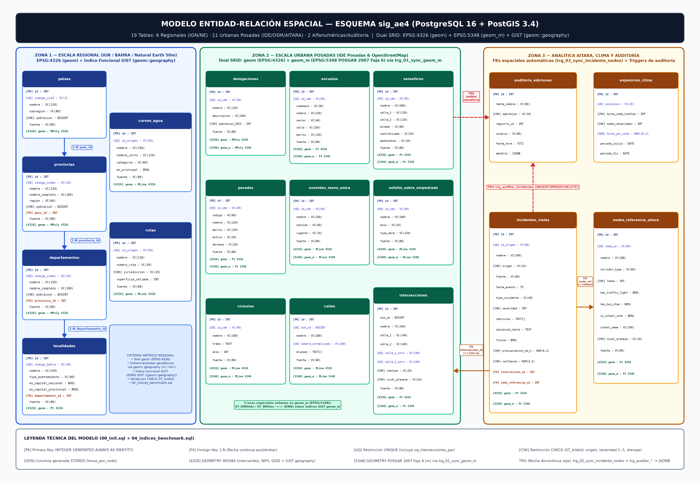

# Modelo Entidad-Relación Espacial (`sig_ae4`)

Documentación estructural de las **19 tablas** del esquema productivo `sig_ae4` (PostgreSQL 16 + PostGIS 3.4), correspondiente exactamente a [`sql/00_init.sql`](../sql/00_init.sql). Además existe el esquema auxiliar `staging` para ingesta cruda previa a la normalización.

## Arquitectura de Sistemas de Referencia y Triggers

- **`geom` (`EPSG:4326`, WGS 84 geográfico)**: presente en las 17 tablas espaciales para intercambio WFS/GeoJSON y visualización directa en QGIS.
- **`geom_m` (`EPSG:5348`, POSGAR 2007 / Argentina Faja 6, metros)**: presente en las 11 tablas urbanas de Posadas y mantenido automáticamente `BEFORE INSERT OR UPDATE OF geom` por `trg_01_sync_geom_m` (`sig_ae4.fn_sync_geom_m()`).
- **`geom::geography`**: criterio métrico geodésico utilizado en las 6 tablas regionales (`paises`, `provincias`, `departamentos`, `localidades`, `cursos_agua`, `rutas`) respaldado por índices funcionales `USING GIST ((geom::geography))` en [`sql/04_indices_benchmark.sql`](../sql/04_indices_benchmark.sql).
- **Vínculo espacial automático de incidentes (`trg_02_sync_incidente_nodos`)**: al insertar o mover `incidentes_viales`, asigna la intersección OSM más cercana dentro de `150 m` (`interseccion_id`) y el nodo experto AITARA más cercano dentro de `500 m` (`nodo_referencia_id`).
- **Auditoría DML (`trg_auditar_semaforos`, `trg_auditar_incidentes`)**: registra `INSERT`, `UPDATE` y `DELETE` en `sig_ae4.auditoria_ediciones` con payload JSONB (`nombre`, `geom_wkt`, `anterior`, `nuevo`).

## Diagrama Mermaid (`erDiagram`)

```mermaid
erDiagram
    paises ||--o{ provincias : "pais_id"
    provincias ||--o{ departamentos : "provincia_id"
    departamentos ||--o{ localidades : "departamento_id"
    intersecciones ||--o{ incidentes_viales : "interseccion_id (<=150m)"
    nodos_referencia_aitara ||--o{ incidentes_viales : "nodo_referencia_id (<=500m)"
    semaforos ||..o{ auditoria_ediciones : "trg_auditar_semaforos"
    incidentes_viales ||..o{ auditoria_ediciones : "trg_auditar_incidentes"

    paises {
        INTEGER id PK "Identificador único"
        VARCHAR_3 codigo_iso3 UK "Código ISO 3166-1 alfa-3"
        VARCHAR_120 nombre "Nombre del país"
        VARCHAR_80 subregion "Subregión geográfica"
        BIGINT poblacion "Población total"
        VARCHAR_80 fuente "Fuente oficial"
        GEOMETRY_MultiPolygon_4326 geom "Límite nacional WGS84"
    }
    provincias {
        INTEGER id PK "Identificador único"
        VARCHAR_10 codigo_indec UK "Código INDEC provincial"
        VARCHAR_120 nombre "Nombre corto"
        VARCHAR_180 nombre_completo "Denominación oficial completa"
        VARCHAR_60 region "Región geográfica (ej. NEA)"
        BIGINT poblacion "Población provincial"
        INTEGER pais_id FK "País contenedor"
        VARCHAR_80 fuente "Fuente oficial"
        GEOMETRY_MultiPolygon_4326 geom "Límite provincial WGS84"
    }
    departamentos {
        INTEGER id PK "Identificador único"
        VARCHAR_10 codigo_indec UK "Código INDEC departamental"
        VARCHAR_120 nombre "Nombre del departamento"
        VARCHAR_180 nombre_completo "Denominación completa"
        BIGINT poblacion "Población departamental"
        INTEGER provincia_id FK "Provincia contenedora"
        VARCHAR_80 fuente "Fuente oficial"
        GEOMETRY_MultiPolygon_4326 geom "Límite departamental WGS84"
    }
    localidades {
        INTEGER id PK "Identificador único"
        VARCHAR_30 codigo_bahra UK "Código censal BAHRA"
        VARCHAR_150 nombre "Nombre de la localidad"
        VARCHAR_80 tipo_asentamiento "Categoría BAHRA"
        BOOLEAN es_capital_nacional "Indicador capital nacional"
        BOOLEAN es_capital_provincial "Indicador capital provincial"
        INTEGER departamento_id FK "Departamento contenedor"
        VARCHAR_80 fuente "Fuente oficial"
        GEOMETRY_Point_4326 geom "Centroide puntual WGS84"
    }
    cursos_agua {
        INTEGER id PK "Identificador único"
        VARCHAR_50 id_origen UK "Identificador IGN de origen"
        VARCHAR_150 nombre "Nombre del curso hídrico"
        VARCHAR_120 nombre_corto "Nombre abreviado"
        VARCHAR_60 categoria "Clasificación hidrográfica"
        BOOLEAN es_principal "Marca de curso principal"
        VARCHAR_80 fuente "Fuente oficial"
        GEOMETRY_MultiLineString_4326 geom "Traza lineal WGS84"
    }
    rutas {
        INTEGER id PK "Identificador único"
        VARCHAR_50 id_origen UK "Identificador IGN de origen"
        VARCHAR_120 nombre "Designación de ruta"
        VARCHAR_30 numero_ruta "Número de ruta"
        VARCHAR_20 jurisdiccion "Jurisdicción vial"
        INTEGER superficie_calzada "Código de tipo de calzada IGN"
        VARCHAR_80 fuente "Fuente oficial"
        GEOMETRY_MultiLineString_4326 geom "Traza vial WGS84"
    }
    delegaciones {
        INTEGER id PK "Identificador único"
        VARCHAR_40 id_ide UK "ID oficial IDE Posadas"
        VARCHAR_120 nombre "Nombre de delegación"
        VARCHAR_180 descripcion "Descripción administrativa"
        INTEGER poblacion_2022 "Población Censo 2022"
        VARCHAR_80 fuente "Fuente oficial"
        GEOMETRY_MultiPolygon_4326 geom "Polígono WGS84"
        GEOMETRY_MultiPolygon_5348 geom_m "Polígono métrico POSGAR 2007 Faja 6"
    }
    semaforos {
        INTEGER id PK "Identificador único"
        VARCHAR_40 id_ide UK "ID oficial IDE Posadas"
        VARCHAR_200 nombre "Identificación del cruce"
        VARCHAR_120 calle_1 "Arteria principal"
        VARCHAR_120 calle_2 "Arteria transversal"
        VARCHAR_60 estado "Estado operativo"
        VARCHAR_20 centralizado "Integración a central semafórica"
        VARCHAR_20 peatonales "Presencia de semáforos peatonales"
        VARCHAR_80 fuente "Fuente oficial"
        GEOMETRY_Point_4326 geom "Ubicación WGS84"
        GEOMETRY_Point_5348 geom_m "Ubicación métrica EPSG:5348"
    }
    escuelas {
        INTEGER id PK "Identificador único"
        VARCHAR_40 id_ide UK "ID oficial IDE Posadas"
        VARCHAR_30 cueanexo "Código CUE-Anexo"
        VARCHAR_220 nombre "Nombre del establecimiento"
        VARCHAR_40 sector "Gestión estatal o privada"
        VARCHAR_150 calle "Dirección vial"
        VARCHAR_120 barrio "Barrio de pertenencia"
        VARCHAR_80 fuente "Fuente oficial"
        GEOMETRY_Point_4326 geom "Ubicación WGS84"
        GEOMETRY_Point_5348 geom_m "Ubicación métrica EPSG:5348"
    }
    paradas {
        INTEGER id PK "Identificador único"
        VARCHAR_40 id_ide UK "ID oficial IDE Posadas"
        VARCHAR_60 codigo "Código operativo de parada"
        VARCHAR_220 nombre "Denominación de parada"
        VARCHAR_120 barrio "Barrio"
        VARCHAR_20 activo "Estado activo"
        VARCHAR_20 darsena "Existencia de dársena"
        VARCHAR_80 fuente "Fuente oficial"
        GEOMETRY_Point_4326 geom "Ubicación WGS84"
        GEOMETRY_Point_5348 geom_m "Ubicación métrica EPSG:5348"
    }
    avenidas_mano_unica {
        INTEGER id PK "Identificador único"
        VARCHAR_40 id_ide UK "ID oficial IDE Posadas"
        VARCHAR_150 nombre "Nombre de avenida"
        VARCHAR_60 sentido "Sentido de circulación"
        VARCHAR_10 vigente "Vigencia normativa"
        VARCHAR_80 fuente "Fuente oficial"
        GEOMETRY_MultiLineString_4326 geom "Eje lineal WGS84"
        GEOMETRY_MultiLineString_5348 geom_m "Eje métrico EPSG:5348"
    }
    asfalto_sobre_empedrado {
        INTEGER id PK "Identificador único"
        VARCHAR_40 id_ide UK "ID oficial IDE Posadas"
        VARCHAR_180 nombre "Tramo intervenido"
        VARCHAR_20 anio "Año de ejecución"
        VARCHAR_120 tipo_obra "Tipología de obra"
        VARCHAR_80 fuente "Fuente oficial"
        GEOMETRY_MultiLineString_4326 geom "Eje lineal WGS84"
        GEOMETRY_MultiLineString_5348 geom_m "Eje métrico EPSG:5348"
    }
    ciclovias {
        INTEGER id PK "Identificador único"
        VARCHAR_40 id_ide UK "ID oficial IDE Posadas"
        VARCHAR_180 nombre "Nombre de ciclovía"
        TEXT tramo "Descripción de tramo"
        INTEGER anio "Año de habilitación"
        VARCHAR_80 fuente "Fuente oficial"
        GEOMETRY_MultiLineString_4326 geom "Eje lineal WGS84"
        GEOMETRY_MultiLineString_5348 geom_m "Eje métrico EPSG:5348"
    }
    calles {
        INTEGER id PK "Identificador único"
        BIGINT osm_id UK "Identificador OpenStreetMap"
        VARCHAR_180 nombre "Nombre de la calle"
        VARCHAR_180 nombre_normalizado UK "Clave textual normalizada"
        TEXT_array aliases "Denominaciones alternativas"
        VARCHAR_80 fuente "Fuente"
        GEOMETRY_MultiLineString_4326 geom "Traza multitramo WGS84"
        GEOMETRY_MultiLineString_5348 geom_m "Traza métrica EPSG:5348"
    }
    intersecciones {
        INTEGER id PK "Identificador único"
        BIGINT osm_id "ID de nodo OpenStreetMap"
        VARCHAR_240 nombre "Nombre del cruce"
        VARCHAR_140 calle_1 "Primera arteria"
        VARCHAR_140 calle_2 "Segunda arteria"
        VARCHAR_140 calle_1_norm UK "Arteria 1 normalizada"
        VARCHAR_140 calle_2_norm UK "Arteria 2 normalizada"
        VARCHAR_20 subtipo "Tipo topológico"
        VARCHAR_10 nivel_drenaje "Nivel de drenaje asignado"
        VARCHAR_80 fuente "Fuente"
        GEOMETRY_Point_4326 geom "Punto de cruce WGS84"
        GEOMETRY_Point_5348 geom_m "Punto métrico EPSG:5348"
    }
    nodos_referencia_aitara {
        INTEGER id PK "Identificador único"
        VARCHAR_60 node_id UK "Código de nodo AITARA"
        VARCHAR_180 nombre "Nombre del nodo/corredor"
        VARCHAR_60 corridor_type "Tipología de corredor"
        INTEGER lanes "Cantidad de carriles"
        BOOLEAN has_traffic_light "Indicador experto de semáforo"
        BOOLEAN has_bus_stop "Indicador experto de parada"
        BOOLEAN is_school_zone "Indicador de entorno escolar"
        VARCHAR_150 school_name "Escuela asociada"
        VARCHAR_10 nivel_drenaje "Capacidad experta de drenaje"
        VARCHAR_80 fuente "Fuente"
        GEOMETRY_Point_4326 geom "Ubicación WGS84"
        GEOMETRY_Point_5348 geom_m "Ubicación métrica EPSG:5348"
    }
    incidentes_viales {
        INTEGER id PK "Identificador único"
        VARCHAR_60 id_origen UK "ID externo/simulación"
        VARCHAR_260 nombre "Título descriptivo del incidente"
        VARCHAR_15 origen "Separación estricta de origen"
        VARCHAR_80 fuente "Fuente del registro"
        TIMESTAMP fecha_evento "Fecha y hora del siniestro"
        VARCHAR_40 tipo_incidente "Tipología del siniestro"
        INTEGER severidad "Escala de gravedad 1 a 5"
        TEXT_array vehiculos "Vehículos involucrados"
        TEXT ubicacion_texto "Texto original de ubicación"
        BOOLEAN llovia "Indicador climático (NULL en reales)"
        NUMERIC_6_2 precipitacion_mm_h "Intensidad de lluvia (mm/h)"
        NUMERIC_4_3 confianza "Confianza de geocodificación"
        INTEGER interseccion_id FK "Intersección OSM <= 150 m"
        INTEGER nodo_referencia_id FK "Nodo experto <= 500 m"
        GEOMETRY_Point_4326 geom "Ubicación WGS84"
        GEOMETRY_Point_5348 geom_m "Ubicación métrica EPSG:5348"
    }
    exposicion_clima {
        INTEGER id PK "Identificador único"
        VARCHAR_20 condicion UK "Condición meteorológica"
        INTEGER horas_nodo_totales "Horas acumuladas totales"
        INTEGER nodos_observados "Cantidad de nodos base"
        NUMERIC_10_2 horas_por_nodo "Horas normalizadas por nodo"
        DATE periodo_inicio "Inicio de ventana"
        DATE periodo_fin "Fin de ventana"
    }
    auditoria_ediciones {
        INTEGER id PK "Identificador único"
        VARCHAR_80 tabla_nombre "Tabla auditada"
        VARCHAR_10 operacion "Operación DML"
        INTEGER registro_id "ID del registro afectado"
        VARCHAR_80 usuario "Rol PostgreSQL ejecutor"
        TIMESTAMPTZ fecha_hora "Marca temporal con zona"
        JSONB detalle "Payload con nombre, geom_wkt, anterior y nuevo"
    }
```

## Diccionario de Datos (19 Tablas)

### 1. Escala Regional — IGN / BAHRA / Natural Earth 50m (6 tablas)

#### `sig_ae4.paises`

- **Fuente:** Natural Earth 50m (complemento IGN)
- **Propósito:** Polígonos nacionales de Sudamérica para contexto geopolítico regional.
- **Notas / Triggers / Índices:** Índices GiST: idx_paises_geom_gist (geom) e idx_paises_geog_gist ((geom::geography)).

| Columna | Tipo SQL | Restricciones | Descripción |
| :--- | :--- | :--- | :--- |
| `id` | `INTEGER` | PK, GENERATED ALWAYS AS IDENTITY | Identificador único |
| `codigo_iso3` | `VARCHAR(3)` | NOT NULL, UNIQUE | Código ISO 3166-1 alfa-3 |
| `nombre` | `VARCHAR(120)` | NOT NULL | Nombre del país |
| `subregion` | `VARCHAR(80)` | NULL | Subregión geográfica |
| `poblacion` | `BIGINT` | CHECK (poblacion >= 0) | Población total |
| `fuente` | `VARCHAR(80)` | NOT NULL DEFAULT 'Natural Earth 50m (complemento IGN)' | Fuente oficial |
| `geom` | `GEOMETRY(MultiPolygon, 4326)` | NOT NULL, CHECK (ST_IsValid(geom)) | Límite nacional WGS84 |

#### `sig_ae4.provincias`

- **Fuente:** IGN
- **Propósito:** Jurisdicciones provinciales argentinas vinculadas a su país.
- **Notas / Triggers / Índices:** Índices GiST: idx_provincias_geom_gist e idx_provincias_geog_gist.

| Columna | Tipo SQL | Restricciones | Descripción |
| :--- | :--- | :--- | :--- |
| `id` | `INTEGER` | PK, GENERATED ALWAYS AS IDENTITY | Identificador único |
| `codigo_indec` | `VARCHAR(10)` | NOT NULL, UNIQUE | Código INDEC provincial |
| `nombre` | `VARCHAR(120)` | NOT NULL | Nombre corto |
| `nombre_completo` | `VARCHAR(180)` | NULL | Denominación oficial completa |
| `region` | `VARCHAR(60)` | NOT NULL | Región geográfica (ej. NEA) |
| `poblacion` | `BIGINT` | CHECK (poblacion >= 0) | Población provincial |
| `pais_id` | `INTEGER` | NOT NULL, FK -> paises(id) | País contenedor |
| `fuente` | `VARCHAR(80)` | NOT NULL DEFAULT 'IGN' | Fuente oficial |
| `geom` | `GEOMETRY(MultiPolygon, 4326)` | NOT NULL, CHECK (ST_IsValid(geom)) | Límite provincial WGS84 |

#### `sig_ae4.departamentos`

- **Fuente:** IGN
- **Propósito:** Departamentos/partidos de Argentina vinculados a su provincia.
- **Notas / Triggers / Índices:** Índices GiST: idx_departamentos_geom_gist e idx_departamentos_geog_gist.

| Columna | Tipo SQL | Restricciones | Descripción |
| :--- | :--- | :--- | :--- |
| `id` | `INTEGER` | PK, GENERATED ALWAYS AS IDENTITY | Identificador único |
| `codigo_indec` | `VARCHAR(10)` | NOT NULL, UNIQUE | Código INDEC departamental |
| `nombre` | `VARCHAR(120)` | NOT NULL | Nombre del departamento |
| `nombre_completo` | `VARCHAR(180)` | NULL | Denominación completa |
| `poblacion` | `BIGINT` | CHECK (poblacion >= 0) | Población departamental |
| `provincia_id` | `INTEGER` | NOT NULL, FK -> provincias(id) | Provincia contenedora |
| `fuente` | `VARCHAR(80)` | NOT NULL DEFAULT 'IGN' | Fuente oficial |
| `geom` | `GEOMETRY(MultiPolygon, 4326)` | NOT NULL, CHECK (ST_IsValid(geom)) | Límite departamental WGS84 |

#### `sig_ae4.localidades`

- **Fuente:** IGN-BAHRA
- **Propósito:** Asentamientos y localidades BAHRA con jerarquía de capitales.
- **Notas / Triggers / Índices:** Índices GiST: idx_localidades_geom_gist e idx_localidades_geog_gist ((geom::geography)).

| Columna | Tipo SQL | Restricciones | Descripción |
| :--- | :--- | :--- | :--- |
| `id` | `INTEGER` | PK, GENERATED ALWAYS AS IDENTITY | Identificador único |
| `codigo_bahra` | `VARCHAR(30)` | NOT NULL, UNIQUE | Código censal BAHRA |
| `nombre` | `VARCHAR(150)` | NOT NULL | Nombre de la localidad |
| `tipo_asentamiento` | `VARCHAR(80)` | NULL | Categoría BAHRA |
| `es_capital_nacional` | `BOOLEAN` | NOT NULL DEFAULT FALSE | Indicador capital nacional |
| `es_capital_provincial` | `BOOLEAN` | NOT NULL DEFAULT FALSE | Indicador capital provincial |
| `departamento_id` | `INTEGER` | NOT NULL, FK -> departamentos(id) | Departamento contenedor |
| `fuente` | `VARCHAR(80)` | NOT NULL DEFAULT 'IGN-BAHRA' | Fuente oficial |
| `geom` | `GEOMETRY(Point, 4326)` | NOT NULL, CHECK (ST_IsValid(geom)) | Centroide puntual WGS84 |

#### `sig_ae4.cursos_agua`

- **Fuente:** IGN
- **Propósito:** Red hidrográfica regional (ríos y arroyos).
- **Notas / Triggers / Índices:** Índices GiST: idx_cursos_agua_geom_gist e idx_cursos_agua_geog_gist.

| Columna | Tipo SQL | Restricciones | Descripción |
| :--- | :--- | :--- | :--- |
| `id` | `INTEGER` | PK, GENERATED ALWAYS AS IDENTITY | Identificador único |
| `id_origen` | `VARCHAR(50)` | NOT NULL, UNIQUE | Identificador IGN de origen |
| `nombre` | `VARCHAR(150)` | NOT NULL | Nombre del curso hídrico |
| `nombre_corto` | `VARCHAR(120)` | NULL | Nombre abreviado |
| `categoria` | `VARCHAR(60)` | NULL | Clasificación hidrográfica |
| `es_principal` | `BOOLEAN` | NOT NULL DEFAULT FALSE | Marca de curso principal |
| `fuente` | `VARCHAR(80)` | NOT NULL DEFAULT 'IGN' | Fuente oficial |
| `geom` | `GEOMETRY(MultiLineString, 4326)` | NOT NULL, CHECK (ST_IsValid(geom)) | Traza lineal WGS84 |

#### `sig_ae4.rutas`

- **Fuente:** IGN
- **Propósito:** Red vial troncal nacional y provincial.
- **Notas / Triggers / Índices:** Índices GiST: idx_rutas_geom_gist e idx_rutas_geog_gist.

| Columna | Tipo SQL | Restricciones | Descripción |
| :--- | :--- | :--- | :--- |
| `id` | `INTEGER` | PK, GENERATED ALWAYS AS IDENTITY | Identificador único |
| `id_origen` | `VARCHAR(50)` | NOT NULL, UNIQUE | Identificador IGN de origen |
| `nombre` | `VARCHAR(120)` | NOT NULL | Designación de ruta |
| `numero_ruta` | `VARCHAR(30)` | NULL | Número de ruta |
| `jurisdiccion` | `VARCHAR(20)` | NOT NULL, CHECK IN ('nacional','provincial') | Jurisdicción vial |
| `superficie_calzada` | `INTEGER` | NULL | Código de tipo de calzada IGN |
| `fuente` | `VARCHAR(80)` | NOT NULL DEFAULT 'IGN' | Fuente oficial |
| `geom` | `GEOMETRY(MultiLineString, 4326)` | NOT NULL, CHECK (ST_IsValid(geom)) | Traza vial WGS84 |

### 2. Escala Urbana Posadas — IDE Posadas & OSM (9 tablas)

#### `sig_ae4.delegaciones`

- **Fuente:** IDE Posadas
- **Propósito:** 12 delegaciones municipales de Posadas con población censal 2022.
- **Notas / Triggers / Índices:** Trigger trg_01_sync_geom_m; índices GiST sobre geom y geom_m.

| Columna | Tipo SQL | Restricciones | Descripción |
| :--- | :--- | :--- | :--- |
| `id` | `INTEGER` | PK, GENERATED ALWAYS AS IDENTITY | Identificador único |
| `id_ide` | `VARCHAR(40)` | UNIQUE | ID oficial IDE Posadas |
| `nombre` | `VARCHAR(120)` | NOT NULL | Nombre de delegación |
| `descripcion` | `VARCHAR(180)` | NULL | Descripción administrativa |
| `poblacion_2022` | `INTEGER` | CHECK (poblacion_2022 >= 0) | Población Censo 2022 |
| `fuente` | `VARCHAR(80)` | NOT NULL DEFAULT 'IDE Posadas' | Fuente oficial |
| `geom` | `GEOMETRY(MultiPolygon, 4326)` | NOT NULL, CHECK (ST_IsValid(geom)) | Polígono WGS84 |
| `geom_m` | `GEOMETRY(MultiPolygon, 5348)` | NULL (sincronizado por trigger) | Polígono métrico POSGAR 2007 Faja 6 |

#### `sig_ae4.semaforos`

- **Fuente:** IDE Posadas
- **Propósito:** Cruces semaforizados oficiales de Posadas (auditados en ediciones).
- **Notas / Triggers / Índices:** Triggers: trg_01_sync_geom_m (BEFORE) y trg_auditar_semaforos (AFTER DML -> auditoria_ediciones).

| Columna | Tipo SQL | Restricciones | Descripción |
| :--- | :--- | :--- | :--- |
| `id` | `INTEGER` | PK, GENERATED ALWAYS AS IDENTITY | Identificador único |
| `id_ide` | `VARCHAR(40)` | UNIQUE | ID oficial IDE Posadas |
| `nombre` | `VARCHAR(200)` | NOT NULL | Identificación del cruce |
| `calle_1` | `VARCHAR(120)` | NULL | Arteria principal |
| `calle_2` | `VARCHAR(120)` | NULL | Arteria transversal |
| `estado` | `VARCHAR(60)` | NULL | Estado operativo |
| `centralizado` | `VARCHAR(20)` | NULL | Integración a central semafórica |
| `peatonales` | `VARCHAR(20)` | NULL | Presencia de semáforos peatonales |
| `fuente` | `VARCHAR(80)` | NOT NULL DEFAULT 'IDE Posadas' | Fuente oficial |
| `geom` | `GEOMETRY(Point, 4326)` | NOT NULL, CHECK (ST_IsValid(geom)) | Ubicación WGS84 |
| `geom_m` | `GEOMETRY(Point, 5348)` | NULL (sincronizado por trigger) | Ubicación métrica EPSG:5348 |

#### `sig_ae4.escuelas`

- **Fuente:** IDE Posadas
- **Propósito:** Establecimientos educativos urbanos de Posadas.
- **Notas / Triggers / Índices:** Trigger trg_01_sync_geom_m; índices GiST sobre geom y geom_m.

| Columna | Tipo SQL | Restricciones | Descripción |
| :--- | :--- | :--- | :--- |
| `id` | `INTEGER` | PK, GENERATED ALWAYS AS IDENTITY | Identificador único |
| `id_ide` | `VARCHAR(40)` | UNIQUE | ID oficial IDE Posadas |
| `cueanexo` | `VARCHAR(30)` | NULL | Código CUE-Anexo |
| `nombre` | `VARCHAR(220)` | NOT NULL | Nombre del establecimiento |
| `sector` | `VARCHAR(40)` | NULL | Gestión estatal o privada |
| `calle` | `VARCHAR(150)` | NULL | Dirección vial |
| `barrio` | `VARCHAR(120)` | NULL | Barrio de pertenencia |
| `fuente` | `VARCHAR(80)` | NOT NULL DEFAULT 'IDE Posadas' | Fuente oficial |
| `geom` | `GEOMETRY(Point, 4326)` | NOT NULL, CHECK (ST_IsValid(geom)) | Ubicación WGS84 |
| `geom_m` | `GEOMETRY(Point, 5348)` | NULL (sincronizado por trigger) | Ubicación métrica EPSG:5348 |

#### `sig_ae4.paradas`

- **Fuente:** IDE Posadas
- **Propósito:** Paradas de transporte público urbano con detalle de dársena.
- **Notas / Triggers / Índices:** Trigger trg_01_sync_geom_m; índices GiST sobre geom y geom_m.

| Columna | Tipo SQL | Restricciones | Descripción |
| :--- | :--- | :--- | :--- |
| `id` | `INTEGER` | PK, GENERATED ALWAYS AS IDENTITY | Identificador único |
| `id_ide` | `VARCHAR(40)` | UNIQUE | ID oficial IDE Posadas |
| `codigo` | `VARCHAR(60)` | NULL | Código operativo de parada |
| `nombre` | `VARCHAR(220)` | NOT NULL | Denominación de parada |
| `barrio` | `VARCHAR(120)` | NULL | Barrio |
| `activo` | `VARCHAR(20)` | NULL | Estado activo |
| `darsena` | `VARCHAR(20)` | NULL | Existencia de dársena |
| `fuente` | `VARCHAR(80)` | NOT NULL DEFAULT 'IDE Posadas' | Fuente oficial |
| `geom` | `GEOMETRY(Point, 4326)` | NOT NULL, CHECK (ST_IsValid(geom)) | Ubicación WGS84 |
| `geom_m` | `GEOMETRY(Point, 5348)` | NULL (sincronizado por trigger) | Ubicación métrica EPSG:5348 |

#### `sig_ae4.avenidas_mano_unica`

- **Fuente:** IDE Posadas
- **Propósito:** Avenidas con circulación de sentido único en Posadas.
- **Notas / Triggers / Índices:** Trigger trg_01_sync_geom_m; índices GiST sobre geom y geom_m.

| Columna | Tipo SQL | Restricciones | Descripción |
| :--- | :--- | :--- | :--- |
| `id` | `INTEGER` | PK, GENERATED ALWAYS AS IDENTITY | Identificador único |
| `id_ide` | `VARCHAR(40)` | UNIQUE | ID oficial IDE Posadas |
| `nombre` | `VARCHAR(150)` | NOT NULL | Nombre de avenida |
| `sentido` | `VARCHAR(60)` | NULL | Sentido de circulación |
| `vigente` | `VARCHAR(10)` | NULL | Vigencia normativa |
| `fuente` | `VARCHAR(80)` | NOT NULL DEFAULT 'IDE Posadas' | Fuente oficial |
| `geom` | `GEOMETRY(MultiLineString, 4326)` | NOT NULL, CHECK (ST_IsValid(geom)) | Eje lineal WGS84 |
| `geom_m` | `GEOMETRY(MultiLineString, 5348)` | NULL (sincronizado por trigger) | Eje métrico EPSG:5348 |

#### `sig_ae4.asfalto_sobre_empedrado`

- **Fuente:** IDE Posadas
- **Propósito:** Obras municipales de pavimentación asfáltica sobre empedrado.
- **Notas / Triggers / Índices:** Trigger trg_01_sync_geom_m; índices GiST sobre geom y geom_m.

| Columna | Tipo SQL | Restricciones | Descripción |
| :--- | :--- | :--- | :--- |
| `id` | `INTEGER` | PK, GENERATED ALWAYS AS IDENTITY | Identificador único |
| `id_ide` | `VARCHAR(40)` | UNIQUE | ID oficial IDE Posadas |
| `nombre` | `VARCHAR(180)` | NOT NULL | Tramo intervenido |
| `anio` | `VARCHAR(20)` | NULL | Año de ejecución |
| `tipo_obra` | `VARCHAR(120)` | NULL | Tipología de obra |
| `fuente` | `VARCHAR(80)` | NOT NULL DEFAULT 'IDE Posadas' | Fuente oficial |
| `geom` | `GEOMETRY(MultiLineString, 4326)` | NOT NULL, CHECK (ST_IsValid(geom)) | Eje lineal WGS84 |
| `geom_m` | `GEOMETRY(MultiLineString, 5348)` | NULL (sincronizado por trigger) | Eje métrico EPSG:5348 |

#### `sig_ae4.ciclovias`

- **Fuente:** IDE Posadas
- **Propósito:** Red de ciclovías y bicisendas urbanas de Posadas.
- **Notas / Triggers / Índices:** Trigger trg_01_sync_geom_m; índices GiST sobre geom y geom_m.

| Columna | Tipo SQL | Restricciones | Descripción |
| :--- | :--- | :--- | :--- |
| `id` | `INTEGER` | PK, GENERATED ALWAYS AS IDENTITY | Identificador único |
| `id_ide` | `VARCHAR(40)` | UNIQUE | ID oficial IDE Posadas |
| `nombre` | `VARCHAR(180)` | NOT NULL | Nombre de ciclovía |
| `tramo` | `TEXT` | NULL | Descripción de tramo |
| `anio` | `INTEGER` | NULL | Año de habilitación |
| `fuente` | `VARCHAR(80)` | NOT NULL DEFAULT 'IDE Posadas' | Fuente oficial |
| `geom` | `GEOMETRY(MultiLineString, 4326)` | NOT NULL, CHECK (ST_IsValid(geom)) | Eje lineal WGS84 |
| `geom_m` | `GEOMETRY(MultiLineString, 5348)` | NULL (sincronizado por trigger) | Eje métrico EPSG:5348 |

#### `sig_ae4.calles`

- **Fuente:** OSM vía AITARA
- **Propósito:** Red vial de calles normalizadas de Posadas reconstruida desde nodos OSM.
- **Notas / Triggers / Índices:** Trigger trg_01_sync_geom_m; índices GiST sobre geom y geom_m.

| Columna | Tipo SQL | Restricciones | Descripción |
| :--- | :--- | :--- | :--- |
| `id` | `INTEGER` | PK, GENERATED ALWAYS AS IDENTITY | Identificador único |
| `osm_id` | `BIGINT` | NOT NULL, UNIQUE | Identificador OpenStreetMap |
| `nombre` | `VARCHAR(180)` | NOT NULL | Nombre de la calle |
| `nombre_normalizado` | `VARCHAR(180)` | NOT NULL, UNIQUE | Clave textual normalizada |
| `aliases` | `TEXT[]` | NULL | Denominaciones alternativas |
| `fuente` | `VARCHAR(80)` | NOT NULL DEFAULT 'OSM vía AITARA' | Fuente |
| `geom` | `GEOMETRY(MultiLineString, 4326)` | NOT NULL, CHECK (ST_IsValid(geom)) | Traza multitramo WGS84 |
| `geom_m` | `GEOMETRY(MultiLineString, 5348)` | NULL (sincronizado por trigger) | Traza métrica EPSG:5348 |

#### `sig_ae4.intersecciones`

- **Fuente:** OSM vía AITARA
- **Propósito:** Nodos y rotondas de cruce entre arterias normalizadas de Posadas.
- **Notas / Triggers / Índices:** Restricción compuesta: CONSTRAINT uq_intersecciones_par UNIQUE (calle_1_norm, calle_2_norm).
- **Notas / Triggers / Índices:** Referenciada por incidentes_viales.interseccion_id (<= 150 m vía trg_02_sync_incidente_nodos).

| Columna | Tipo SQL | Restricciones | Descripción |
| :--- | :--- | :--- | :--- |
| `id` | `INTEGER` | PK, GENERATED ALWAYS AS IDENTITY | Identificador único |
| `osm_id` | `BIGINT` | NOT NULL | ID de nodo OpenStreetMap |
| `nombre` | `VARCHAR(240)` | NOT NULL | Nombre del cruce |
| `calle_1` | `VARCHAR(140)` | NOT NULL | Primera arteria |
| `calle_2` | `VARCHAR(140)` | NOT NULL | Segunda arteria |
| `calle_1_norm` | `VARCHAR(140)` | NOT NULL, UNIQUE(calle_1_norm, calle_2_norm) | Arteria 1 normalizada |
| `calle_2_norm` | `VARCHAR(140)` | NOT NULL, UNIQUE(calle_1_norm, calle_2_norm) | Arteria 2 normalizada |
| `subtipo` | `VARCHAR(20)` | NOT NULL, CHECK IN ('nodo','rotonda') | Tipo topológico |
| `nivel_drenaje` | `VARCHAR(10)` | CHECK IN ('ALTO','MEDIO','BAJO') | Nivel de drenaje asignado |
| `fuente` | `VARCHAR(80)` | NOT NULL DEFAULT 'OSM vía AITARA' | Fuente |
| `geom` | `GEOMETRY(Point, 4326)` | NOT NULL, CHECK (ST_IsValid(geom)) | Punto de cruce WGS84 |
| `geom_m` | `GEOMETRY(Point, 5348)` | NULL (sincronizado por trigger) | Punto métrico EPSG:5348 |

### 3. Analítica AITARA, Exposición Climática y Auditoría (4 tablas)

#### `sig_ae4.nodos_referencia_aitara`

- **Fuente:** AITARA (atributo experto)
- **Propósito:** Nodos de corredores críticos AITARA con atributos expertos y nivel de drenaje.
- **Notas / Triggers / Índices:** Referenciada por incidentes_viales.nodo_referencia_id (<= 500 m vía trg_02_sync_incidente_nodos).

| Columna | Tipo SQL | Restricciones | Descripción |
| :--- | :--- | :--- | :--- |
| `id` | `INTEGER` | PK, GENERATED ALWAYS AS IDENTITY | Identificador único |
| `node_id` | `VARCHAR(60)` | NOT NULL, UNIQUE | Código de nodo AITARA |
| `nombre` | `VARCHAR(180)` | NOT NULL | Nombre del nodo/corredor |
| `corridor_type` | `VARCHAR(60)` | NOT NULL | Tipología de corredor |
| `lanes` | `INTEGER` | CHECK (lanes > 0) | Cantidad de carriles |
| `has_traffic_light` | `BOOLEAN` | NULL | Indicador experto de semáforo |
| `has_bus_stop` | `BOOLEAN` | NULL | Indicador experto de parada |
| `is_school_zone` | `BOOLEAN` | NULL | Indicador de entorno escolar |
| `school_name` | `VARCHAR(150)` | NULL | Escuela asociada |
| `nivel_drenaje` | `VARCHAR(10)` | NOT NULL, CHECK IN ('ALTO','MEDIO','BAJO') | Capacidad experta de drenaje |
| `fuente` | `VARCHAR(80)` | NOT NULL DEFAULT 'AITARA (atributo experto)' | Fuente |
| `geom` | `GEOMETRY(Point, 4326)` | NOT NULL, CHECK (ST_IsValid(geom)) | Ubicación WGS84 |
| `geom_m` | `GEOMETRY(Point, 5348)` | NULL (sincronizado por trigger) | Ubicación métrica EPSG:5348 |

#### `sig_ae4.incidentes_viales`

- **Fuente:** AITARA (reales + simulados)
- **Propósito:** Hechos viales reales y simulados con enlace automático a intersecciones y nodos AITARA.
- **Notas / Triggers / Índices:** Triggers: trg_01_sync_geom_m -> trg_02_sync_incidente_nodos (BEFORE) y trg_auditar_incidentes (AFTER).

| Columna | Tipo SQL | Restricciones | Descripción |
| :--- | :--- | :--- | :--- |
| `id` | `INTEGER` | PK, GENERATED ALWAYS AS IDENTITY | Identificador único |
| `id_origen` | `VARCHAR(60)` | UNIQUE | ID externo/simulación |
| `nombre` | `VARCHAR(260)` | NOT NULL | Título descriptivo del incidente |
| `origen` | `VARCHAR(15)` | NOT NULL, CHECK IN ('real','simulado') | Separación estricta de origen |
| `fuente` | `VARCHAR(80)` | NOT NULL | Fuente del registro |
| `fecha_evento` | `TIMESTAMP` | NOT NULL | Fecha y hora del siniestro |
| `tipo_incidente` | `VARCHAR(40)` | NOT NULL | Tipología del siniestro |
| `severidad` | `INTEGER` | NOT NULL, CHECK (1..5) | Escala de gravedad 1 a 5 |
| `vehiculos` | `TEXT[]` | NULL | Vehículos involucrados |
| `ubicacion_texto` | `TEXT` | NULL | Texto original de ubicación |
| `llovia` | `BOOLEAN` | NULL | Indicador climático (NULL en reales) |
| `precipitacion_mm_h` | `NUMERIC(6,2)` | CHECK (precipitacion_mm_h >= 0) | Intensidad de lluvia (mm/h) |
| `confianza` | `NUMERIC(4,3)` | CHECK (confianza BETWEEN 0 AND 1) | Confianza de geocodificación |
| `interseccion_id` | `INTEGER` | FK -> intersecciones(id) | Intersección OSM <= 150 m |
| `nodo_referencia_id` | `INTEGER` | FK -> nodos_referencia_aitara(id) | Nodo experto <= 500 m |
| `geom` | `GEOMETRY(Point, 4326)` | NOT NULL, CHECK (ST_IsValid(geom)) | Ubicación WGS84 |
| `geom_m` | `GEOMETRY(Point, 5348)` | NULL (sincronizado por trigger) | Ubicación métrica EPSG:5348 |

#### `sig_ae4.exposicion_clima`

- **Fuente:** AITARA (simulado/exposición)
- **Propósito:** Horas de exposición climática para normalizar tasas lluvia vs. seco.
- **Notas / Triggers / Índices:** Tabla alfanumérica usada como denominador de tasas en 03_consultas_autoria.sql (Autoría 2A y 2C).

| Columna | Tipo SQL | Restricciones | Descripción |
| :--- | :--- | :--- | :--- |
| `id` | `INTEGER` | PK, GENERATED ALWAYS AS IDENTITY | Identificador único |
| `condicion` | `VARCHAR(20)` | NOT NULL, UNIQUE, CHECK IN ('lluvia','seco') | Condición meteorológica |
| `horas_nodo_totales` | `INTEGER` | NOT NULL, CHECK (> 0) | Horas acumuladas totales |
| `nodos_observados` | `INTEGER` | NOT NULL DEFAULT 7, CHECK (> 0) | Cantidad de nodos base |
| `horas_por_nodo` | `NUMERIC(10,2)` | GENERATED ALWAYS AS (horas_nodo_totales::NUMERIC / nodos_observados) STORED | Horas normalizadas por nodo |
| `periodo_inicio` | `DATE` | NOT NULL DEFAULT '2023-01-01' | Inicio de ventana |
| `periodo_fin` | `DATE` | NOT NULL DEFAULT '2025-12-31' | Fin de ventana |

#### `sig_ae4.auditoria_ediciones`

- **Fuente:** Triggers PL/pgSQL (fn_auditar_edicion)
- **Propósito:** Bitácora inmutable de INSERT, UPDATE y DELETE sobre semaforos e incidentes_viales.
- **Notas / Triggers / Índices:** Poblada automáticamente por trg_auditar_semaforos y trg_auditar_incidentes.

| Columna | Tipo SQL | Restricciones | Descripción |
| :--- | :--- | :--- | :--- |
| `id` | `INTEGER` | PK, GENERATED ALWAYS AS IDENTITY | Identificador único |
| `tabla_nombre` | `VARCHAR(80)` | NOT NULL | Tabla auditada |
| `operacion` | `VARCHAR(10)` | NOT NULL, CHECK IN ('INSERT','UPDATE','DELETE') | Operación DML |
| `registro_id` | `INTEGER` | NULL | ID del registro afectado |
| `usuario` | `VARCHAR(80)` | NOT NULL DEFAULT current_user | Rol PostgreSQL ejecutor |
| `fecha_hora` | `TIMESTAMPTZ` | NOT NULL DEFAULT now() | Marca temporal con zona |
| `detalle` | `JSONB` | NULL | Payload con nombre, geom_wkt, anterior y nuevo |
