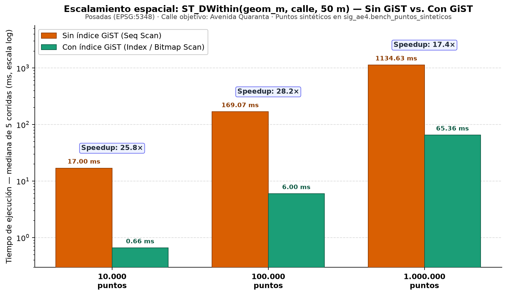

# Benchmark Espacial GiST & Geography — AE4 SIG

- **Fecha de ejecución**: `2026-11-23 01:23:58 UTC`
- **PostgreSQL**: `PostgreSQL 16.4 (Debian 16.4-1.pgdg110+2)`
- **PostGIS**: `POSTGIS="3.4.3 e365945" [EXTENSION] PGSQL="160" GEOS="3.9.0-CAPI-1.16.2" PROJ="7.2.1 NETWORK_ENABLED=OFF URL_ENDPOINT=https://cdn.proj.org USER_WRITABLE_DIRECTORY=/var/lib/postgresql/.local/share/proj DATABASE_PATH=/usr/share/proj/proj.db" LIBXML="2.9.10" LIBJSON="0.15" LIBPROTOBUF="1.3.3" WAGYU="0.5.0 (Internal)" TOPOLOGY`
- **Iteraciones por escenario**: `5` (reportando la **mediana** de `Execution Time` y buffers desde `EXPLAIN (ANALYZE, BUFFERS, FORMAT JSON)`)
- **Índices GiST restaurados al finalizar (`04_indices_benchmark.sql`)**: `34`

## Conteos de tablas evaluadas

| Tabla (`sig_ae4`) | Registros |
| --- | ---: |
| `intersecciones` | 7,898 |
| `calles` | 1,286 |
| `incidentes_viales` | 1,429 |
| `delegaciones` | 12 |
| `localidades` | 3,528 |
| `cursos_agua` | 1,333 |

## 1. Consultas espaciales reales: Sin GiST vs. Con GiST

| Consulta | Filas | Sin GiST (ms) | Con GiST (ms) | Speedup | Buffers Sin GiST (hit / read) | Buffers Con GiST (hit / read) | Plan observado (Sin → Con) |
| --- | ---: | ---: | ---: | ---: | ---: | ---: | --- |
| 1) intersecciones × calles (`ST_DWithin(..., 30 m)`) | 18,194 | 4009.167 | 337.744 | **11.87×** | 362 / 0 | 310,279 / 0 | `Nested Loop -> Seq Scan (intersecciones) -> Materialize -> Seq Scan (calles)` → `Nested Loop -> Seq Scan (calles) -> Index Scan (idx_bench_intersecciones_geom_m)` |
| 2) incidentes_viales × delegaciones (`ST_Within`) | 1,201 | 22.916 | 1.779 | **12.88×** | 11,488 / 0 | 2,383 / 0 | `Nested Loop -> Seq Scan (incidentes_viales) -> Materialize -> Seq Scan (delegaciones)` → `Nested Loop -> Seq Scan (delegaciones) -> Index Scan (idx_bench_incidentes_geom_m)` |
| 3) localidades × cursos_agua (KNN `<->` `CROSS JOIN LATERAL`) | 3,528 | 5459.990 | 114.235 | **47.80×** | 1,238,382 / 0 | 35,833 / 0 | `Nested Loop -> Seq Scan (localidades) -> Limit -> Sort -> Seq Scan (cursos_agua)` → `Nested Loop -> Seq Scan (localidades) -> Limit -> Index Scan (idx_bench_cursos_agua_geom)` |

## 2. Trampa del cast `geom::geography` (`localidades × cursos_agua`, `ST_DWithin(..., 200000)`)

Un índice GiST estándar sobre `geom` (tipo `geometry`, SRID 4326) **no** es utilizable cuando la consulta castea en tiempo de ejecución a `geom::geography`; se requiere un índice funcional `USING GIST ((geom::geography))`.

| Escenario | Filas | Mediana (ms) | Min / Max (ms) | Buffers (hit / read) | Plan observado |
| --- | ---: | ---: | ---: | ---: | --- |
| Solo índice GiST en `geom` (4326) | 176,665 | 240178.937 | 239142.973 / 242146.740 | 282,565 / 0 | `Nested Loop -> Seq Scan (localidades) -> Materialize -> Seq Scan (cursos_agua)` |
| Con índice GiST funcional `(geom::geography)` | 176,665 | 4078.849 | 4063.195 / 4194.696 | 45,853 / 0 | `Nested Loop -> Seq Scan (cursos_agua) -> Index Scan (idx_bench_localidades_geog)` |

- **Speedup al crear el índice funcional `(geom::geography)`**: **58.88×**.

## 3. Escalamiento sintético (`sig_ae4.bench_puntos_sinteticos` × `Avenida Quaranta` [id=1088], `ST_DWithin(..., 50)`)

| Puntos sintéticos | Coincidencias (≤50 m) | Sin GiST (ms) | Con GiST (ms) | Speedup | Buffers Sin GiST (hit / read) | Buffers Con GiST (hit / read) |
| ---: | ---: | ---: | ---: | ---: | ---: | ---: |
| 10,000 | 57 | 17.005 | 0.660 | **25.77×** | 87 / 0 | 463 / 0 |
| 100,000 | 538 | 169.070 | 6.003 | **28.16×** | 837 / 0 | 874 / 0 |
| 1,000,000 | 5,188 | 1134.634 | 65.363 | **17.36×** | 3,008,336 / 0 | 8,600 / 0 |

