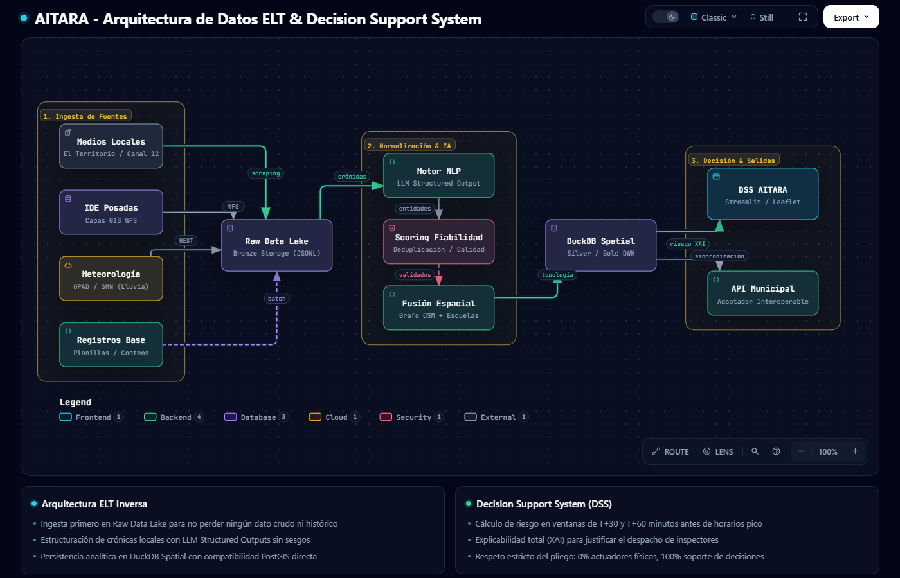
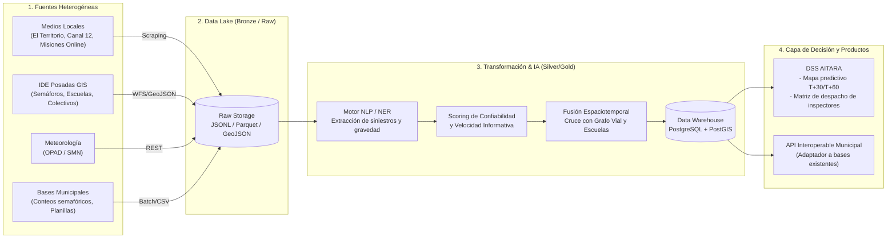

# Propuesta de Solución Técnica: Plataforma AITARA
**Arquitectura ELT y Sistema de Soporte de Decisiones (DSS)**  
**Hackathon Silicon Misiones 2026**

---

## 1. Visión de la Solución
AITARA se concibe como una **infraestructura de datos adaptable y anexable** para la Municipalidad de Posadas. Resuelve la brecha de información desde la base operativa (captura y estructuración de datos dispersos) hasta la cúspide de decisión (DSS predictivo para el despacho de inspectores y mitigación de siniestros).

---

## 2. Diagrama de Arquitectura (Pipeline ELT)

> **Interactivo:** Podés explorar el diagrama dinámico con zoom, paneo y modo oscuro en [`architecture/aitara-archify.html`](architecture/aitara-archify.html) o ver el fuente declarativo en [`architecture/aitara.architecture.json`](architecture/aitara.architecture.json).

*(El código fuente Graphviz equivalente se encuentra disponible en `docs/architecture/pipeline.dot`)*.

---

## 3. Desglose del Pipeline ELT

### E (Extract) — Ingesta Multimodal
- **Minería de Medios Locales:** Scraping continuo y resiliente sobre portales de noticias (El Territorio, Canal 12, Misiones Online) para detectar reportes de siniestros y cortes viales que el municipio hoy lee a mano.
- **Capas GIS de IDE Posadas:** Descarga automatizada de capas territoriales (escuelas, semáforos, paradas y sentidos de calles).
- **Contexto Meteorológico:** Extracción periódica de precipitaciones y alertas de OPAD/SMN.
- **Conectores Municipales:** Ingesta por lotes (batch) de planillas y conteos de semáforos existentes sin forzar al municipio a cambiar sus sistemas actuales.

### L (Load) — Data Lake Centralizado (Bronze Layer)
- Almacenamiento en crudo de todas las fuentes sin alterar el formato original.
- Garantiza trazabilidad, auditoría forense de accidentes y capacidad de reentrenar modelos futuros sin pérdida de información histórica.

### T (Transform) — Enriquecimiento e Inteligencia Artificial (Silver / Gold Layers)
- **Extracción de Entidades (NLP/NER):** Procesamiento de las crónicas para identificar esquinas exactas, vehículos involucrados (motos, colectivos), horario y nivel de daño.
- **Scoring Informativo:** Evaluación de la velocidad y consistencia de los reportes para descartar falsos positivos o notas duplicadas.
- **Geocodificación y Fusión Espacial:** Cruce de los incidentes con la red vial (`OSMnx`) y capas de equipamiento urbano (IDE Posadas).
- **Consolidación en Data Warehouse Relacional:** Modelado dimensional listo para consultas espaciales en milisegundos.

---

## 4. Productos Derivados y Escalabilidad
1. **AITARA DSS (Decision Support System):** Tablero operativo para el despachador de tránsito con semáforo de riesgo proyectado a $T+30$ y $T+60$ minutos, y recomendación de asignación de inspectores.
2. **Capa API Municipal Anexable:** Endpoints REST/GeoJSON que permiten a cualquier sistema existente de la Municipalidad de Posadas consultar los datos limpios y enriquecidos sin fricción.
